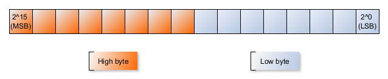
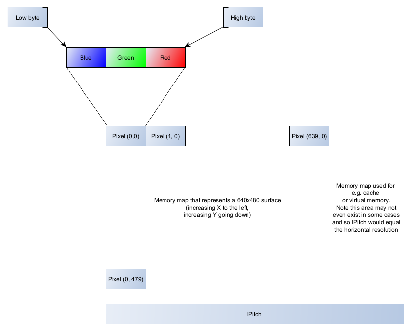

# DirectDraw Graphics Part 1

This article extends the DirectDraw setup and foundation from [the previous section](9_DirectDraw.md), covering topics such as:

+ High-colour modes
+ Double buffering and page flipping
+ The _blitter_ (part of the microprocesser that transfer and modifies data in memory, for the CPU)
+ Clipping
+ Bitmaps
+ Colour animation
+ Working with windowed DirectX applications

## High-colour modes

8-bit colour mode applications are good starting points when learning the fundamentals, and with much older hardware 
and/or software-based rasterisers (e.g. the [DirectX9 2D engine](https://github.com/jfspps/DirectX2DEngine)) are
all that is available. 

Working with higher colour modes places more demands because of:

+ increased computational requirements: working with an 8-bit palette can be acccomplished by a per-pixel basis, while 16-bit and 24-bit colour modes will require more sophisticated and consequently slower conversions or very large lookup tables
+ increased GPU memory bandwidth requirements: only new AGP (accelerated graphics port) or PCI-E (peripheral component interconnect) _express_ interfaces can sufficiently handle high-colour modes appreciably

### 16-bit colour modes

The actual colour mode available is decided by the hardware manufacturer. DirectX provides functions that enable an application to query the colour modes on offer.

Some examples of 16-bit colour modes include:

+ __Alpha.5.5.5__ - this can visualised as three 5-bit blocks for red, green and blue colours, with the 16th bit dedicated to the _alpha_ component (for image transparency). Each block can store a value up to 2<sup>5</sup> i.e. 32 values or shades of a given colour. This results in a palette matrix of 32x32x32 i.e. 32,768 colours.
+ __X.5.5.5__ - this is similar to Alpha.5.5.5 except the transparency bit (the MSB, or most significant bit, see below excursion) is not used/is ignored.
+ __5.6.5__ - the most common 16-bit colour mode, with a 5-bit block for red and blue, and a 6-bit block for green (human eyes are more sensitive to green, so it was decided to add more range to the green spectrum). Overall that's 32x64x32 or 65,536 colours.

#### Little endian and big endian ordering

A little excursion about how memory is ordered at the bit level.

A _word_ is a fixed size/length block in memory that represents a unique operand, the dimensions of which are CPU dependent.

A colour word, in this article series, represents the block of memory that stores the red, green and blue shades for a given pixel. For 16-bit colour words (used for 16-bit colour modes) the 0th bit is known as the _least significant bit_ (LSB) and the 15th bit is known as the _most significant bit_ (MSB).



When a word is ordered ("filled", if preferred) from the LSB first (as PCs do), the word adopts a __little endian__ format. RGB colour words are organised such that red occupies the higher-order bits (e.g. the 10th to the 15th bits), with blue occupying the lower-order bits, and green somewhere in between. When assigning values red then green then blue in code, it is necessary to order (initialise) the word starting from the MSB. As such colour words adopt a __big-endian__ format.

#### Building the colour word

With the above in mind, the following macros can be used to build colour words (as 2-byte `USHORT`) after passing 4-byte `int` for each red, green and blue parameter:

```cpp
// Alpha.5.5.5, returns a 16-bit USHORT; the parameters are typically 32-bit int
#define _RGB16BIT555(r, g, b) (((r & 31) << 10) + ((g & 31) << 5) + (b & 31))
```

The blue (int) colour is masked so as to fit within the first 31 (2<sup>5</sup> - 1) values (the first five bits), the green colour is masked similarly but with an additional left-shift of 5 bits (equivalent to multipling the green shade by 2<sup>5</sup>), and finally the red colour is masked and left-shifted by 10 bits.

#### Getting the pixel format

The RGB encoding available (the _pixel format_) is hardware dependent and therefore must be known by the application prior to rendering. One can deduce the pixel format with `IDIRECTDRAWSURFACE7::GetPixelFormat()`:

```cpp
HRESULT GetPixelFormat(LPDDPIXELFORMAT lpDDPixelFormat);
```

The sole parameter `LPDDPIXELFORMAT` is a pointer to `DDPIXELFORMAT` which is updated by `GetPixelFormat()` with information about the pixel format. One then queries the parameter (assuming the call hasn't failed) to determine the pixel format.

Assuming that the DirectDraw primary surface (`lpdds_primary`) has already by initialised:

```cpp
// assume this was initialised
LPDIRECTDRAWSURFACE7 lpdds_primary;

// this will store the pixel format
DDPIXELFORMAT ddPixel;

// memset to fill memory block with zeros, to prep ddPixel
memset(&ddPixel, 0, sizeof(ddPixel));
ddPixel.dwSize = sizeof(ddPixel);

lpdds_primary->GetPixelFormat(&ddPixel);

// now check the valid flags to determine the pixel format
if (ddPixel.dwFlags & DDPF_RGB){

	// DDPF_RGB indicates that the surface is an RGB mode 
	// and can be queried via dwRGBBitCount

	switch(ddPixel.dwRGBBitCount)
	{
		case 15: {
			// 5.5.5 mode in use; can use the _RGB16BIT555 macro
		} break;
		case 16: {
			// 5.6.5 mode in use
		} break;
		case 24: {
			// 8.8.8 mode in use
		} break;
		case 32: {
			// alpha(8).8.8.8 mode in use
		} break;

		default: break;
	}
} else {
	if (ddPixel.dwFlags & DDPF_PALETTEINDEXED8){
		// DDPF_PALETTEINDEXED8 indicates 256 (8-bit) colour palettised mode
	} else {
		// something other pixel format...
	}
}
```

So far, we need four variables/pointers to store:

+ DirectDraw7 interface pointer (`LPDIRECTDRAW7`)
+ DirectDraw surface description (`DDSURFACEDESC2`)
+ DirectDraw primary surface pointer (`LPDIRECTDRAWSURFACE7`)
+ Pixel format/RGB encoding provided (`DDPIXELFORMAT`)

### Plotting pixels in 16-bit

The [previous section](./9_DirectDraw.md#how-pixels-are-plotted) covered pixel plotting in some detail in 8-bit. In this section, we cover plotting pixels in 16-bit, i.e. without the need for a palette and instead referring to the pixel format of the hardware.

Like 8-bit colour modes, we still need to lock (and unlock) the video buffer. In general, one should minimise the number of times a buffer is locked and then unlocked: locking and unlocking buffers is expensive.

```cpp
// builds a 16-bit colour value in 5.6.5 format (green dominant);
// note the green spectrum is 6 bits so covers (2^6 - 1) or 63 values
#define _RGB16BIT565(r, g, b) (((r & 31) << 11) + ((g & 63) << 5) + (b & 31))


// locking is handled outside this function so that we don't lock/unlock on a
// per pixel basis 
inline void plotPixel16(
	int x, int y,
	int red, int green, int blue,
	USHORT *videoBuffer, int lPitch)
	{
		USHORT pixel = _RGB16BIT565(red, green, blue);

		// write the data;
		// recall lPitch is the memory width in bytes (8-bit blocks);
		// we adjust to a 16-bit block with a right-shift 
		videoBuffer[x + y*(lPitch >> 1)] = pixel;
	}
```

In general, it is preferable to lock the buffer and draw all that is required before unlocking the buffer. The following shows this in action, and would be applied during a game loop:

#### 24-bit and 32-bit colour modes

24-bit colour modes use three 8-bit (on byte) per channel. An byte can hold up to 2<sup>8</sup> or 256 values, and hence across the RGB mode, there are 256x256x256 = 16.7 million colours. The red, green and blue channels are equally distributed, unlike 16-bit 5.6.5 mode, which is green heavy.

Since 24-bits is made up of three 8-bit blocks, the x- address for each colour word is located every three bytes. Within a colour word, the ordering from the low byte is still blue, then green, and then (the high byte) red.



The video buffer elements are of type `DWORD` (a 32-bit unsigned int). As shown above, the blue channel of pixel (0,0) resides in memory at 0, the green channel is one 32-bit int above this, and finally red is another above.

Plotting pixels in 24-bit mode involves setting the colour word with each colour channel in step, rather than apply bitwise operations as e.g. 16-bit macro that yield the entire colour word:

```cpp
// again, assume buffer locking and unlocking is handled outside this function;
// recall UCHAR is an unsigned 8-bit int
inline void plotPixel24(
	int x, int y,
	int red, int green, int blue,
	UCHAR *videoBuffer, int lPitch){
		// DWORD 32-bit unsigned int as the address of the colour 
		// for the pixel (x, y)
		DWORD pixelAddress = (x + x + x) + (y * lPitch);

		// no bit fiddling here, simply set the colours in the 
		// buffer in the order B then G then R 
		videoBuffer[pixelAddress] = blue;
		videoBuffer[pixelAddress + 1] = green;
		videoBuffer[pixelAddress + 2] = red;
	}
```

An equivalent macro that sets the colour word would be:

```cpp
#define _RGB24BIT(r, g, b) (b + (g << 8) + (r << 16))
```

32-bit colour modes follow in that the blue channel resides in the low byte and each channel occupies 8-bits.

+ __Alpha(8).8.8.8__ - the high byte represents the alpha channel (usually for transparency but also for
other purposes). Being a 32-bit word, this fits entirely within 32-bit CPU registers.
+ __X(8).8.8__ - this is similar to Alpha(8).8.8.8 but the alpha channel is not used at all.

It may seem as though 32-bit colours modes are redundant given that they don't perform much more than 24-bit. Both
support about 16.7 million colours. The situation is some GPUs do not support or address three-byte words and require a fourth byte to align words correctly. Hence, DirectX applications sometimes ignore 24-bit modes altogether and go with 
32-bit colour modes without offering 24-bit colour modes.

We can extend the 16-bit pixel plotting function to suit 32-bit colours modes:

```cpp
// builds a 32-bit colour value as a WORD
#define _RGB32BIT(alpha, r, g, b) (b + (g << 8) + (r << 16) + (alpha << 24))

// (32-bit) DWORD pitch
int lPitch32 = lPitch >> 2; 

// locking is handled outside this function so that we don't lock/unlock on a
// per pixel basis 
inline void plotPixel132(
	int x, int y,
	int alpha, int red, int green, int blue,
	UINT *videoBuffer, int lPitch32)
	{
		// UINT is a 32-bit unsigned int
		UINT pixel = _RGB32BIT(alpha, red, green, blue);

		// write the data;
		// lPitch is in 4 byte (32-bit) blocks
		videoBuffer[x + y*(lPitch32)] = pixel;
	}
```

## Double buffering and page flipping

Drawing to an offscreen surface allows applications to hide surface operations (removing elements, updating pixel colours etc.) from viewers. 

The process of drawing to an offscreen area and then copying it to a surface is known as _double buffering_.

A similar operation, known as _page flipping_. This is where the application draws to one of e.g. two visible areas (surfaces) and before directing the hardware to display to newly drawn surface. Instead of copying an image to a surface, the hardware points to a different portion of memory.

### Implementing double buffering

In short, one allocates a portion of memory for the offscreen area with the same resolution as the primary surface, fills the buffer with the next scene, before copying it to the primary surface.

Copying the data is somewhat involved, in that the memory stride (pitch) of the primary surface determines which C++ operations are required.

If the stride equals the horizontal resolution (i.e. there are no extraneous elements to the memory row) then one can call `memcpy()` e.g.:

```cpp
// UCHAR is an unsigned 8-bit int
UCHAR * primaryBuffer;
// ...assume the primary buffer is already initialised

UCHAR * doubleBuffer = new UCHAR[640*480];
// ...assume the double buffer is filled later...
// e.g. doubleBuffer[x + (640*y)] = someColour

// the last parameter of memcpy() is the number of bytes to copy 
// (from doubleBuffer to primaryBuffer)
memcpy((void *) primaryBuffer, (void *) doubleBuffer, 640*480); 
```

If the stride is greater than the horizontal resolution, then one needs to skip the extraneous elements by advancing a pointer:

```cpp
// UCHAR is an unsigned 8-bit int
UCHAR * primaryBuffer;
// ...assume the primary buffer is already initialised

UCHAR * doubleBuffer = new UCHAR[640*480];
// ...assume the double buffer is filled later...
// e.g. doubleBuffer[x + (640*y)] = someColour

for (int y = 0; y < 480; y++){
	
	// copy the first 640 bytes (each pixel is one byte or 8-bits)
	memcpy((void *) primaryBuffer, (void *) doubleBuffer, 640);

	// memPitch is in number of bytes;
	// advance the primary surface buffer by memPitch bytes
	primaryBuffer += memPitch;

	// get ready for the next line of pixels
	doubleBuffer += 640;
}
```
