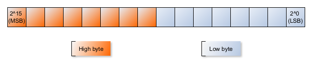
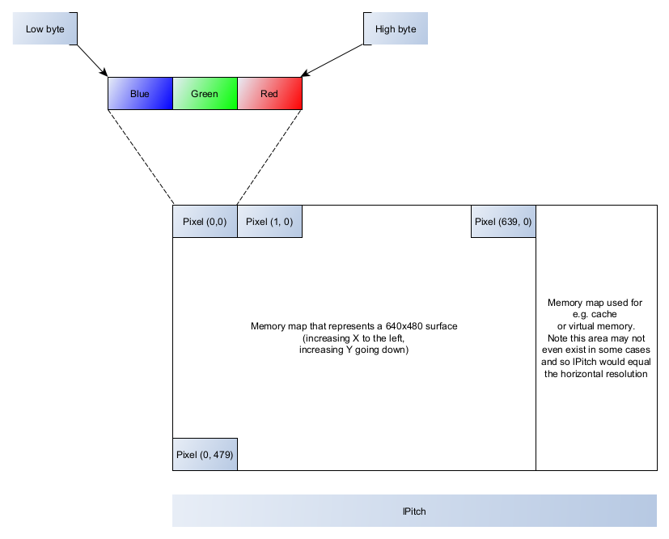
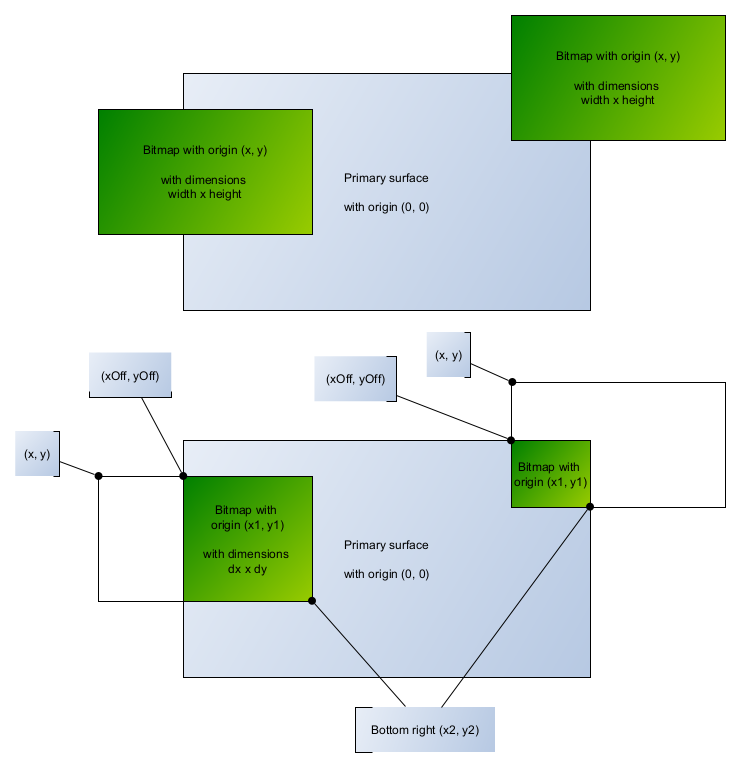

# DirectDraw Graphics Part 1

This article extends the DirectDraw setup and foundation from [the previous section](9_DirectDraw.md), covering topics such as:

+ High-colour modes
+ Double buffering and page flipping
+ The _blitter_ (part of the microprocesser that transfer and modifies data in memory, for the CPU)
+ Clipping
+ Bitmaps
+ Colour animation
+ Working with windowed DirectX applications

## High-colour modes

8-bit colour mode applications are good starting points when learning the fundamentals, and with much older hardware 
and/or software-based rasterisers (e.g. the [DirectX9 2D engine](https://github.com/jfspps/DirectX2DEngine)) are
all that is available. 

Working with higher colour modes places more demands because of:

+ increased computational requirements: working with an 8-bit palette can be acccomplished by a per-pixel basis, while 16-bit and 24-bit colour modes will require more sophisticated and consequently slower conversions or very large lookup tables
+ increased GPU memory bandwidth requirements: only new AGP (accelerated graphics port) or PCI-E (peripheral component interconnect) _express_ interfaces can sufficiently handle high-colour modes appreciably

### 16-bit colour modes

The actual colour mode available is decided by the hardware manufacturer. DirectX provides functions that enable an application to query the colour modes on offer.

Some examples of 16-bit colour modes include:

+ __Alpha.5.5.5__ - this can visualised as three 5-bit blocks for red, green and blue colours, with the 16th bit dedicated to the _alpha_ component (for image transparency). Each block can store a value up to 2<sup>5</sup> i.e. 32 values or shades of a given colour. This results in a palette matrix of 32x32x32 i.e. 32,768 colours.
+ __X.5.5.5__ - this is similar to Alpha.5.5.5 except the transparency bit (the MSB, or most significant bit, see below excursion) is not used/is ignored.
+ __5.6.5__ - the most common 16-bit colour mode, with a 5-bit block for red and blue, and a 6-bit block for green (human eyes are more sensitive to green, so it was decided to add more range to the green spectrum). Overall that's 32x64x32 or 65,536 colours.

#### Little endian and big endian ordering

A little excursion about how memory is ordered at the bit level.

A _word_ is a fixed size/length block in memory that represents a unique operand, the dimensions of which are CPU dependent.

A colour word, in this article series, represents the block of memory that stores the red, green and blue shades for a given pixel. For 16-bit colour words (used for 16-bit colour modes) the 0th bit is known as the _least significant bit_ (LSB) and the 15th bit is known as the _most significant bit_ (MSB).



When a word is ordered ("filled", if preferred) from the LSB first (as PCs do), the word adopts a __little endian__ format. RGB colour words are organised such that red occupies the higher-order bits (e.g. the 10th to the 15th bits), with blue occupying the lower-order bits, and green somewhere in between. When assigning values red then green then blue in code, it is necessary to order (initialise) the word starting from the MSB. As such colour words adopt a __big-endian__ format.

#### Building the colour word

With the above in mind, the following macros can be used to build colour words (as 2-byte `USHORT`) after passing 4-byte `int` for each red, green and blue parameter:

```cpp
// Alpha.5.5.5, returns a 16-bit USHORT; the parameters are typically 32-bit int
#define _RGB16BIT555(r, g, b) (((r & 31) << 10) + ((g & 31) << 5) + (b & 31))
```

The blue (int) colour is masked so as to fit within the first 31 (2<sup>5</sup> - 1) values (the first five bits), the green colour is masked similarly but with an additional left-shift of 5 bits (equivalent to multipling the green shade by 2<sup>5</sup>), and finally the red colour is masked and left-shifted by 10 bits.

#### Getting the pixel format

The RGB encoding available (the _pixel format_) is hardware dependent and therefore must be known by the application prior to rendering. One can deduce the pixel format with `IDIRECTDRAWSURFACE7::GetPixelFormat()`:

```cpp
HRESULT GetPixelFormat(LPDDPIXELFORMAT lpDDPixelFormat);
```

The sole parameter `LPDDPIXELFORMAT` is a pointer to `DDPIXELFORMAT` which is updated by `GetPixelFormat()` with information about the pixel format. One then queries the parameter (assuming the call hasn't failed) to determine the pixel format.

Assuming that the DirectDraw primary surface (`lpdds_primary`) has already by initialised:

```cpp
// assume this was initialised
LPDIRECTDRAWSURFACE7 lpdds_primary;

// this will store the pixel format
DDPIXELFORMAT ddPixel;

// memset to fill memory block with zeros, to prep ddPixel
memset(&ddPixel, 0, sizeof(ddPixel));
ddPixel.dwSize = sizeof(ddPixel);

lpdds_primary->GetPixelFormat(&ddPixel);

// now check the valid flags to determine the pixel format
if (ddPixel.dwFlags & DDPF_RGB){

	// DDPF_RGB indicates that the surface is an RGB mode 
	// and can be queried via dwRGBBitCount

	switch(ddPixel.dwRGBBitCount)
	{
		case 15: {
			// 5.5.5 mode in use; can use the _RGB16BIT555 macro
		} break;
		case 16: {
			// 5.6.5 mode in use
		} break;
		case 24: {
			// 8.8.8 mode in use
		} break;
		case 32: {
			// alpha(8).8.8.8 mode in use
		} break;

		default: break;
	}
} else {
	if (ddPixel.dwFlags & DDPF_PALETTEINDEXED8){
		// DDPF_PALETTEINDEXED8 indicates 256 (8-bit) colour palettised mode
	} else {
		// something other pixel format...
	}
}
```

So far, we need four variables/pointers to store:

+ DirectDraw7 interface pointer (`LPDIRECTDRAW7`)
+ DirectDraw surface description (`DDSURFACEDESC2`)
+ DirectDraw primary surface pointer (`LPDIRECTDRAWSURFACE7`)
+ Pixel format/RGB encoding provided (`DDPIXELFORMAT`)

### Plotting pixels in 16-bit

The [previous section](./9_DirectDraw.md#how-pixels-are-plotted) covered pixel plotting in some detail in 8-bit. In this section, we cover plotting pixels in 16-bit, i.e. without the need for a palette and instead referring to the pixel format of the hardware.

Like 8-bit colour modes, we still need to lock (and unlock) the video buffer. In general, one should minimise the number of times a buffer is locked and then unlocked: locking and unlocking buffers is expensive.

```cpp
// builds a 16-bit colour value in 5.6.5 format (green dominant);
// note the green spectrum is 6 bits so covers (2^6 - 1) or 63 values
#define _RGB16BIT565(r, g, b) (((r & 31) << 11) + ((g & 63) << 5) + (b & 31))


// locking is handled outside this function so that we don't lock/unlock on a
// per pixel basis 
inline void plotPixel16(
	int x, int y,
	int red, int green, int blue,
	USHORT *videoBuffer, int lPitch)
	{
		USHORT pixel = _RGB16BIT565(red, green, blue);

		// write the data;
		// recall lPitch is the memory width in bytes (8-bit blocks);
		// we adjust to a 16-bit block with a right-shift 
		videoBuffer[x + y*(lPitch >> 1)] = pixel;
	}
```

In general, it is preferable to lock the buffer and draw all that is required before unlocking the buffer. The following shows this in action, and would be applied during a game loop:

#### 24-bit and 32-bit colour modes

24-bit colour modes use three 8-bit (on byte) per channel. An byte can hold up to 2<sup>8</sup> or 256 values, and hence across the RGB mode, there are 256x256x256 = 16.7 million colours. The red, green and blue channels are equally distributed, unlike 16-bit 5.6.5 mode, which is green heavy.

Since 24-bits is made up of three 8-bit blocks, the x- address for each colour word is located every three bytes. Within a colour word, the ordering from the low byte is still blue, then green, and then (the high byte) red.



The video buffer elements are of type `DWORD` (a 32-bit unsigned int). As shown above, the blue channel of pixel (0,0) resides in memory at 0, the green channel is one 32-bit int above this, and finally red is another above.

Plotting pixels in 24-bit mode involves setting the colour word with each colour channel in step, rather than apply bitwise operations as e.g. 16-bit macro that yield the entire colour word:

```cpp
// again, assume buffer locking and unlocking is handled outside this function;
// recall UCHAR is an unsigned 8-bit int
inline void plotPixel24(
	int x, int y,
	int red, int green, int blue,
	UCHAR *videoBuffer, int lPitch){
		// DWORD 32-bit unsigned int as the address of the colour 
		// for the pixel (x, y)
		DWORD pixelAddress = (x + x + x) + (y * lPitch);

		// no bit fiddling here, simply set the colours in the 
		// buffer in the order B then G then R 
		videoBuffer[pixelAddress] = blue;
		videoBuffer[pixelAddress + 1] = green;
		videoBuffer[pixelAddress + 2] = red;
	}
```

An equivalent macro that sets the colour word would be:

```cpp
#define _RGB24BIT(r, g, b) (b + (g << 8) + (r << 16))
```

32-bit colour modes follow in that the blue channel resides in the low byte and each channel occupies 8-bits.

+ __Alpha(8).8.8.8__ - the high byte represents the alpha channel (usually for transparency but also for
other purposes). Being a 32-bit word, this fits entirely within 32-bit CPU registers.
+ __X(8).8.8__ - this is similar to Alpha(8).8.8.8 but the alpha channel is not used at all.

It may seem as though 32-bit colours modes are redundant given that they don't perform much more than 24-bit. Both
support about 16.7 million colours. The situation is some GPUs do not support or address three-byte words and require a fourth byte to align words correctly. Hence, DirectX applications sometimes ignore 24-bit modes altogether and go with 
32-bit colour modes without offering 24-bit colour modes.

We can extend the 16-bit pixel plotting function to suit 32-bit colours modes:

```cpp
// builds a 32-bit colour value as a WORD
#define _RGB32BIT(alpha, r, g, b) (b + (g << 8) + (r << 16) + (alpha << 24))

// (32-bit) DWORD pitch
int lPitch32 = lPitch >> 2; 

// locking is handled outside this function so that we don't lock/unlock on a
// per pixel basis 
inline void plotPixel132(
	int x, int y,
	int alpha, int red, int green, int blue,
	UINT *videoBuffer, int lPitch32)
	{
		// UINT is a 32-bit unsigned int
		UINT pixel = _RGB32BIT(alpha, red, green, blue);

		// write the data;
		// lPitch is in 4 byte (32-bit) blocks
		videoBuffer[x + y*(lPitch32)] = pixel;
	}
```

## Double buffering and page flipping

Drawing to an offscreen surface allows applications to hide surface operations (removing elements, updating pixel colours etc.) from viewers. 

The process of drawing to an offscreen area and then copying it to a surface is known as _double buffering_.

A similar operation, known as _page flipping_. This is where the application draws to one of e.g. two visible areas (surfaces) before directing the hardware to display to newly drawn surface. Instead of copying an image to a surface, the hardware points to a different portion of memory.

### Implementing double buffering

In short, one allocates a portion of memory for the offscreen area with the same resolution as the primary surface, fills the buffer with the next scene, before copying it to the primary surface.

Copying the data is somewhat involved, in that the memory stride (pitch) of the primary surface determines which C++ operations are required.

If the stride equals the horizontal resolution (i.e. there are no extraneous elements to the memory row) then one can call `memcpy()` e.g.:

```cpp
// UCHAR is an unsigned 8-bit int
UCHAR * primaryBuffer;
// ...assume the primary buffer is already initialised

UCHAR * doubleBuffer = new UCHAR[640*480];
// ...assume the double buffer is filled later...
// e.g. doubleBuffer[x + (640*y)] = someColour

// the last parameter of memcpy() is the number of bytes to copy 
// (from doubleBuffer to primaryBuffer)
memcpy((void *) primaryBuffer, (void *) doubleBuffer, 640*480); 
```

If the stride is greater than the horizontal resolution, then one needs to skip the extraneous elements by advancing a pointer:

```cpp
// UCHAR is an unsigned 8-bit int
UCHAR * primaryBuffer;
// ...assume the primary buffer is already initialised

UCHAR * doubleBuffer = new UCHAR[640*480];
// ...assume the double buffer is filled later...
// e.g. doubleBuffer[x + (640*y)] = someColour

for (int y = 0; y < 480; y++){
	
	// copy the first 640 bytes (each pixel is one byte or 8-bits)
	memcpy((void *) primaryBuffer, (void *) doubleBuffer, 640);

	// memPitch is in number of bytes;
	// advance the primary surface buffer by memPitch bytes
	primaryBuffer += memPitch;

	// get ready for the next line of pixels
	doubleBuffer += 640;
}
```

### Complex surfaces

Surfaces can be described as _primary surfaces_ or _secondary surfaces_. Secondary surfaces are part of an animation chain that have the same resolution and colour depth as the primary surface. One can utilise page flipping to point the primary display to the next secondary surface.

Each offscreen surface (secondary surface) is a _back buffer_, and usually occupies the GPU VRAM. Page flipping in such cases is generally much faster than copying data between surfaces, though the number of back buffers is limited by the resolution requested and the amount of VRAM available.

For 8-bit colour depth, an `m*n` resolution will require `m*n` bytes per surface. A more common application which requires 16-bit colour depth with double buffering (i.e. one back buffer) will require `2*2*m*n` bytes of VRAM (e.g. 640x480 at 16-bit with double buffering is 1,228,800 bytes, roughly 1.2 MB; likewise 2560x1440 at 32-bit colour depth with double buffering requires 7,372,800 bytes).

Creating a back buffer and relating it to the primary surface (in preparation for page flipping) is carried out in DirectX by creating a _complex surface_. Reviewing the procedure set out [here](./9_DirectDraw.md#b-building-a-display-surface)

```cpp
// assume the DirectDraw interface pointer lpdd7 has been initialised

// pointer to the PRIMARY surface interface
LPDIRECTDRAWSURFACE7 lpddsprimary = NULL;

// pointer to A BACK BUFFER interface
LPDIRECTDRAWSURFACE7 lpddsBack = NULL;

// the surface description
DDSURFACEDESC2 ddsd;

// a general recommendation to clear (really fill with zeros) and prep ddsd
// with memset()
memset(&ddsd, 0, sizeof(ddsd));

// start initialising the structure's fields
ddsd.dwSize = sizeof(ddsd);

// the application can expect valid surface settings: 
// ddsCaps (for DirectDraw) and a back buffer count (one in this case)
ddsd.dwFlags = DDSD_CAPS | DDSD_BACKBUFFERCOUNT;

// now set the capabilities of the chosen field(s)

// set the back buffer count
ddsd.dwBackBufferCount = 1;

// set up for a complex, flippable surface
ddsd.ddsCaps.dwCaps = DDSCAPS_PRIMARYSURFACE | DDSCAPS_COMPLEX | DDSCAPS_FLIP;

// now create the primary surface, and initialise lpddsprimary
if (FAILED(lpdd7->CreateSurface(&ddsd, &lpddsprimary, NULL))){
    // failed to build the primary surface, clean up and exit
}

// get ready to request the back buffer
ddsd.ddsCaps.dwCaps = DDSCAPS_BACKBUFFER;

// now request the attached back buffer
if (FAILED(lpddsprimary->GetAttachedSurface(&ddsd.ddsCaps, &lpddsBack))){
	return (0);
}

// okay, now establised with the primary lpddsprimary
// and secondary surface lpddsBack...
```

To draw to the back buffer, simply lock the surface, draw to it then unlock it. The flip the page...this is decribed next.

### Page flipping

Despite first appearances, a page-flipping mechanism does not change the definition of primary or secondary surfaces. A back buffer is _always_ offscreen, with the primary surface _always_ onscreen. That is, even though the pointer to a surface is updated during page flipping, the back buffer does not _become_ the primary surface, and neither does the primary surface become a back buffer.

To flip the primary surface use `Flip()` (one does not flip a back buffer), the signature is given below:

```cpp
HRESULT Flip(LPDIRECTDRAWSURFACE7 lpDDSurfaceTargetOverride, DWORD dwFlags);
```

The first parameter is advanced and passing NULL is normally fine. The second parameter is one of the following control flag:

+ DDLIP_INTERVAL2 - flip after two retraces (vertical sync)
+ DDLIP_INTERVAL3 - flip after three retraces
+ DDLIP_INTERVAL4 - flip after four retraces
+ DDFLIP_NOVSYNC - flip as close as possible to the next (monitor) scan line
+ DDFLIP_WAIT - wait until a flip is possible (commonly used control flag)

The first three flags indicate how many vertical retraces to wait between each flip (defaults to one), and are only
valid if `DDSCAPS2_FLIPINTERVAL` is declared by the `ddsd` surface description.

Both the back buffer and primary surface must be unlocked before the primary surface is flipped.

```cpp
// this approach allows for repeated attempts
while(FAILED(lpddsprimary->Flip(NULL,  DDFLIP_WAIT)));
```

### The blitter (bit block transfers)

From a basic standpoint, drawing a bitmap to a surface involves can involve copying each pixel. 
For example, an 8x8 256-colour (8-bit) bitmap can be copied to a 640*480 surface at position (x,y) by the blitter as follows:

```cpp
UCHAR *videoBuffer;
// assume this is initialised with an 8x8 image
UCHAR *bitmap;

int x;
int y;

// for each row of the bitmap
for (int bmY = 0; bmY < 8; bmY++){ 

	// for each pixel along a row
	for (int bmX = 0; bmX < 8; bmX++){
		// pitch is 640 pixels; the origin (top-left) of the bitmap is at (x,y) on the surface
		// and fills the surface to the right and below relative to this
		videoBuffer[(x + bmX) + (y + bmY)*640] = bitmap[bmX + (bmY*8)];
	}
}
```

The above code will copy everything over, including pixels that should be ignored i.e. transparent pixels (value of 0).

The above can be optimised to remove some of the addition and multiplication operators (in favour of bitwise operators) 
and ignore transparent pixels, with:

```cpp
UCHAR *videoBuffer;
// assume this is initialised with an 8x8 image
UCHAR *bitmap;

int x;
int y;

// get the starting point on the surface
// i.e. videoBuffer += (x + (y)*640)
videoBuffer += (x + (y << 9) + (y << 7));

// used to read/write pixels
UCHAR currentPixel;

for (int bmY = 0; bmY < 8; bmY++){ 

	// for each pixel along a row
	for (int bmX = 0; bmX < 8; bmX++){
		if (currentPixel = bitmap[bmX]){
			// currentPixel > 0, not transparent
			videoBuffer[bmX] = currentPixel;
		}
	}

	bitmap += 8; // next row
	videoBuffer += 640; // next line
}
```

The hardware blitter frees up the processor to work on other aspects.

DirectDraw provides two bitting methods, `IDIRECTDRAWSURFACE7::Blt()` and ``IDIRECTDRAWSURFACE7::BltFast()`. The former is more comprehensive, supporting additional features such as clipping, while the latter is simpler and consequently faster in simpler contexts.

```cpp
HRESULT Blt(
	LPRECT lpDestRect,
	LPDIRECTDRAWSURFACE7 lpDDSrcSurface,
	LPRECT lpSrcRect,
	DWORD dwFlags,
	LPDDBLTFX lpDDBltFx
)
```

+ `LPRECT lpDestRect` - the rectangle (portion of destination surface) to blit to (if NULL then blit to the entire surface)
+ `LPDIRECTDRAWSURFACE7 lpDDSrcSurface` - the address to the source surface
+ `LPRECT lpSrcRect` - the rectangle (portion of source surface) to blit from (if NULL then blit from the entire surface)
+ `DWORD dwFlags` - defines blitting behaviour or operations, e.g. scaling, rotation
+ `LPDDBLTFX lpDDBltFx` - an extensive structure detailing blitting properties e.g. special effects, what operations are supported

As mentioned, `BltFast()` is simpler:

```cpp
HRESULT BltFast(
	DWORD dwX,
	DWORD dwY
	LPDIRECTDRAWSURFACE7 lpDDSrcSurface,
	LPRECT lpSrcRect,
	DWORD dwTrans
)
```

The parameters `dwX` and `dwY` represent the x and y coordinates to blit to (on the destination surface). The last parameter `dwTrans` defines the type of blitter operation e.g. whether to adopt the source or destinations colour key 
(which colours should be treated as transparent, see [later](#colour-keys)), or just copy with no transparency.

#### Filling a surface with a colour with the blitter

To fill a region of an 8-bit colour surface:

```cpp
DDBLTFX ddBltFx;
RECT destRect;

// initialise the FX structure
memset(&ddBltFx, 0, sizeof(ddBltFx));
ddBltFx.dwSize = sizeof(ddBltFx);

// for 8-bit mode only e.g. colourIndex some value 0-255
// (actual colour is palette dependent);
// for higher modes e.g. for 16-bit mode green use
// ddBltFx.dwFillColor = __RGB16BIT565(0, 255, 0);
ddBltFx.dwFillColor = colourIndex;

// upper-left inclusive, these pixels are included
destRect.left = x1;
destRect.top = y1;

// lower-right exclusive, these pixels are a boundary,
// so really (x2 - 1) and (y2 - 1) are the lower right pixels
// included
destRect.right = x2;
destRect.bottom = y2;

lpddsPrimary->Blt(
	destRect,
	NULL,
	NULL,
	DDBLT_COLORFILL | DDBLT_WAIT,
	&ddBltFx
);
```

The `dwFlags` `DDBLT_COLORFILL` and `DDBLT_WAIT` passed instruct the application to fill the destination surface with an RGB colour and wait until blitting is completed.

#### Blitting from a back buffer to the primary surface

The power of blitting is really the domain of moving bitmaps in blocks. This is often useful for _sprites_ (bitmaps that
move around the screen).

Blitting can only take place if the source and destination surfaces are defined. One can also blit from surfaces that are not related to the primary surface, though in the next example, we will blit from a back buffer (secondary surface) to the primary surface. (Later, when handling bitmaps is covered, this example can be extended to blit bitmaps.)

Following a slight modification to the colour fill blitter example:

```cpp
// we don't require the Blt FX structure

RECT sourceRect, destRect;

sourceRect.left = x1;
sourceRect.top = y1;
sourceRect.right = x2;
sourceRect.bottom = y2;

destRect.left = x3;
destRect.top = y3;
destRect.right = x4;
destRect.bottom = y4;

lpddsPrimary->Blt(
	destRect,
	NULL,
	&sourceRect,
	DDBLT_WAIT,
	NULL
);
```

### Clipping

_Clipping_ is the process of ignoring or omitting pixels or parts of an image that would otherwise be out of bounds of
the viewport or window. DirectDraw does not support clipping of pixels or lines, so this must be implemented manually. DirectDraw does however support clipping of bitmaps.

#### Clipping on a pixel basis

To illustrate, one can define a rectangular region outside of which pixels will not be rendered.

```cpp
// assume these define the upper-left and lower-right boundaries
// and are inclusive (pixels can occupy the boundary too)
int x1, y1, x2, y2;

// attempt to plot a pixel at (x, y) on a 640x480 8-bit surface
void plotPixelAndClip(
	int x,
	int y,
	UCHAR colour,
	UCHAR *videoBuffer){
		
		if (x >= x1 && x <= x2 && y >= y1 && y <= y2){
			videoBuffer[x + (y*640)];
		}
}
```

To take into account the viewport dimensions, one can generalise the above as follows:

```cpp
// assume these define the upper-left boundaries
// and are inclusive (pixels can occupy the boundary too)
int x1, y1;

// assume these viewport dimensions are already defined;
// we don't allow pixels to occupy the right and bottom boundaries
int width, height;

// attempt to plot a pixel at (x, y) on a 640x480 8-bit surface
void plotPixelAndClip(
	int x,
	int y,
	UCHAR colour,
	UCHAR *videoBuffer){
		
		if (x >= x1 && x < width && y >= y1 && y < height){
			videoBuffer[x + (y*640)];
		}
}
```

#### Clipping without DirectDraw

As mentioned, DirectDraw support bitmap clipping. First, we review how to clip in software mode.

This can be achieved by overlaying the bitmap on the destination surface (e.g. the primary surface)
and then clipping the bitmap where it lies outside of the viewport.

Let us assume the bitmap of dimensions `width` x `height` is first overlayed at a point (x, y) which may or may not reside in the viewport, with dimensions `viewWidth` x `viewHeight`. We overlay the bitmap, then identify the portion of the bitmap that does lie inside the viewport and only draw what lies inside the viewport.



```cpp
int viewWidth = 640;
int viewHeight = 480;

void blitClipped(
	int x,
	int y,
	int width,
	int height,
	UCHAR *bitmap,
	UCHAR *videoBuffer,
	int memPitch){
		// make sure the bitmap top-left (origin) isn't out of the viewport
		// or bitmap bottom-right isn't above and to the left of the viewport origin
		if ((x >= viewWidth) || (y >= viewHeight) || 
				(x + width <= 0) || (y + height) <= 0){
			return;
		}

		// some of the bitmap is in the viewport, overlay it
		// and find out, from the viewport's perspective, where the top-left
		// and bottom-right of the bitmap are (exclusive)
		int x1 = x;
		int y1 = y;

		// bottom-right at most is determined by width
		// and height
		int x2 = x1 + width - 1;
		int y2 = y1 + height - 1;

		// now check both corners don't reside outside
		// the viewport and adjust if so
		if (x1 < 0){
			// can't draw top-left any further to the left
			x1 = 0;
		}

		if (y1 < 0){
			// can't draw top-left any further upwards
			y1 = 0;
		}

		if (x2 >= viewWidth){
			// can't draw bottom-right any further to the right
			x2 = viewWidth - 1;
		}

		if (y2 >= viewHeight){
			// can't draw bottom-right any further downwards
			y2 = viewHeight - 1;
		}

		// now determine the (offset) origin of the bitmap
		// from the viewport's perspective
		int xOff = x1 - x;
		int yOff = y1 - y;
		
		// determine the no. of columns and rows
		// of the bitmap to blit (this defines the 
		// area of the clipped bitmap)
		int dx = x2 - x1 + 1;
		int dy = y2 - y1 + 1;

		// determine where blitting starts
		// within the viewport (buffer)
		videoBuffer += (x1 + (y1 * memPitch));

		// determine where bitmap scanning 
		// starts (within the bitmap array)
		bitmap += (xOff + (yOff * width));

		// clipping prepared, start blitting
		UCHAR currentPixel;

		// for each row in the clipped bitmap
		for (int bmY = 0; bmY < dy; bmY++){ 

			// for each pixel along a row
			for (int bmX = 0; bmX < dx; bmX++){
				if (currentPixel = bitmap[bmX]){
					// currentPixel > 0, not transparent
					videoBuffer[bmX] = currentPixel;
				}
			}

			bitmap += memPitch; // next row
			videoBuffer += width; // next line
		}
	}
```

#### Clipping with DirectDraw

Instead of invoking a custom clipper, as above, one can utilise methods from the `IDirectDrawClipper` interface. To clip with DirectDraw:

1. Create a clipper with `IDirectDrawClipper::CreateClipper()`
2. Create a _clipping list_: a list of `RECT` structures for each clipped bitmap in the viewport [so the above example would involve two rectangles]. DirectDraw will only blit within the rectangles i.e. the _clip list_.
3. Set the clip list to the clipper
4. Attach the clipper to the surface or window

The method `IDIRECTDRAW7::CreateClipper()` can in most cases be used without consideration to the parameters, as:

```cpp
// assume DIRECTDRAW7 lpdd7 was initialised

// this will refer to the clipper
LPDIRECTDRAWCLIPPER lpddclipper = NULL;

if (FAILED(lpdd7->CreateClipper(0, &lpddclipper, NULL))){
	// failed to create clipper, clean up and leave
	return(0);
}
```

Creating a clipping list involves using a rather old data structure `RGNDATA`:

```cpp
typedef struct _RGNDATA{
	RGNDATAHEADER rdh;
	char Buffer[1];
} RGNDATA;
```

The rectangles (the clipping list) is stored in a `Buffer` array (which can change in length dynamically). The
array is stored in the stack and must be allocated appropriately before building the clipping list.

The `RGNDATAHEADER` acts as the header of a `RGNDATA` instance (_region data_) and is followed immediately (and continuously) by the `Buffer` array. The header contains information related to the array:

```cpp
typedef struct _RGNDATAHEADER {
	DWORD dwSize; // size of header in bytes
	DWORD iType; // type of region data
	DWORD nCount; // number of rectangles as RECTs
	DWORD nRgnSize; // size of Buffer[]
	RECT rcBound; // a bounding box around all RECTs
} RGNDATAHEADER;
```

(An example of initialising the clipping list will be given shortly.)

With the clipping list initialised, one then sets the clipping list with `IDIRECTDRAWCLIPPER::SetClipList()`. 
Finally, one then attaches the clipper to the surface with `IDIRECTDRAWSURFACE7::SetClipper()` (again, there is usually one one way to call these methods so the prototypes are not given here).

```cpp
// assume DIRECTDRAW7 lpdd7 was initialised

// this will refer to the clipper
LPDIRECTDRAWCLIPPER lpddclipper = NULL;

if (FAILED(lpdd7->CreateClipper(0, &lpddclipper, NULL))){
	// failed to create clipper, clean up and leave
	return(0);
}

// initialise the clipping list 
// (skipped here for now)

// assume this holds both the header and Buffer of RECTs
LPRGNDATA regionData;

if (FAILED(lpddclipper->SetClipList(&regionData, 0))){
	// failed to set clipping list to clipper, clean up and leave
	return (0);
}

// now attach clipper to surface (assume it is lpddsurface)
if (FAILED(lpddsurface->SetClipper(&lpddclipper))){
	// failed to set clipper to surface, clean up and leave
	return (0);
}
```

The clip list would take the form of an array of RECTs, for example:

```cpp
RECT rectList[3] = {
	{10, 10, 50, 50},
	{100, 100, 200, 200},
	{300, 300, 500, 450}
};
```

The code to set up the region data based on the above array is best managed by a function:

```cpp
LPDIRECTDRAWCLIPPER attachClipper(
	LPDIRECTDRAWSURFACE7 lpdds, int numRects, LPRECT clipList){

	int index;                         // looping var
	LPDIRECTDRAWCLIPPER lpddclipper;   // pointer to the newly created dd clipper
	LPRGNDATA regionData;             // pointer to the region data

	// first create the DirectDraw clipper
	if (FAILED(lpdd7->CreateClipper(0, &lpddclipper, NULL)))
		return(NULL);

	// create the clip list....

	// first allocate memory for region data
	regionData = 
		(LPRGNDATA)malloc(sizeof(RGNDATAHEADER) + (numRects * sizeof(RECT)));

	// now copy the rects into region data
	memcpy(regionData->Buffer, clipList, (numRects * sizeof(RECT)));

	// set up fields of header
	regionData->rdh.dwSize          = sizeof(RGNDATAHEADER);
	regionData->rdh.iType           = RDH_RECTANGLES;
	regionData->rdh.nCount          = numRects;
	regionData->rdh.nRgnSize        = numRects * sizeof(RECT);

	// set the bounding rectangle
	regionData->rdh.rcBound.left    =  64000;
	regionData->rdh.rcBound.top     =  64000;
	regionData->rdh.rcBound.right   = -64000;
	regionData->rdh.rcBound.bottom  = -64000;

	// find bounds of all clipping regions
	for (index = 0; index < numRects; index++){
		// test if the next rectangle unioned with the current bound is larger
		if (clipList[index].left < regionData->rdh.rcBound.left)
		regionData->rdh.rcBound.left = clipList[index].left;

		if (clipList[index].right > regionData->rdh.rcBound.right)
		regionData->rdh.rcBound.right = clipList[index].right;

		if (clipList[index].top < regionData->rdh.rcBound.top)
		regionData->rdh.rcBound.top = clipList[index].top;

		if (clipList[index].bottom > regionData->rdh.rcBound.bottom)
		regionData->rdh.rcBound.bottom = clipList[index].bottom;

	}

	// now we have computed the bounding rectangle region and set up the data
	// now let's set the clipping list

	if (FAILED(lpddclipper->SetClipList(regionData, 0))){
		// release memory and return error
		free(regionData);
		return(NULL);
	}

	// now attach the clipper to the surface
	if (FAILED(lpdds->SetClipper(lpddclipper))){
		// release memory and return error
		free(regionData);
		return(NULL);
	}

	// all is well, so release memory and send back the pointer to the new clipper
	free(regionData);
	return(lpddclipper);
}
```

Calling the function is straighforward to the back buffer:

```cpp
LPDIRECTDRAWCLIPPER lpddclipper = attachClipper(lpddsback, 3, rectList);
```

### Bitmaps

There are numerous examples of bitmap files, including `.pcx` (PC Paint), `.tga` (Targa), `.png` (Portable Network Graphics) and (native to Windows) `.bmp`. This section applies solely on the latter.

A bitmap is composed of three parts, with an associated Win32 data structure:

+ Bitmap file header, `BITMAPFILEHEADER`
+ Bitmap info section, `BITMAPINFOHEADER`
+ Bitmap data area, byte stream (array)

The bitmap file header is defined as:

```cpp
typedef struct tagBITMAPFILEHEADER {
	WORD bfType; // file type, 0x4D42 for .bmp
	DWORD bfSize; // file size in bytes
	WORD bfReserved1; // leave as 0
	WORD bfReserved2; // leave as 0
	DWORD bfOffBits; // offset or size of bitmap info in bytes
} BITMAPFILEHEADER;
```

The bitmap info section is composed of `BITMAPINFOHEADER` and (if required) `RGBQUAD`, the RGB palette information.

```cpp
typedef struct tagBITMAPINFOHEADER {
  DWORD biSize;		// no. of bytes required by this struct
  LONG  biWidth;	// bitmap width in pixels
  LONG  biHeight;	// bitmap height in pixels (see below re. orientation)
  WORD  biPlanes;	// no. of colour planes, must be 1
  WORD  biBitCount; // bits per pixel i.e. 1, 4, 8, 16, 24 or 32
  DWORD biCompression;	// type of compression, use BI_RGB for most cases
  DWORD biSizeImage;	// image size in bytes
  LONG  biXPelsPerMeter;	// no. of pixels per meter along x-axis
  LONG  biYPelsPerMeter;	// no. of pixels per meter along y-axis
  DWORD biClrUsed;	// no. of colours used by the this bitmap, 
  					// usually 256 for 8-bit and 0 for higher
  DWORD biClrImportant;	// no. of important colours used by this bitmap,
						// usually 256 for 8-bit and 0 for higher
} BITMAPINFOHEADER;
```

The palette applies to 8-bit colour modes and would then require an `RGBQUAD` instance:

```cpp
typedef struct tagRGBQUAD{
	BYTE rgbBlue;
	BYTE rgbGreen;
	BYTE rgbRed;
	BYTE rgbReserved;
}
```

If the parameter `biHeight` is negative then the bitmap is _top-down DIB_ (device-independent bitmap) with an origin
at the top-left corner. Contrastingly, a positive `biHeight` is a _bottom-up DIB_ with the origin at the lower-left corner. Most bitmaps are bottom-up.

The bitmap data area is byte stream that defines the image pixels, in a line-by-line order. As implied by `biHeight`, the image will be upside-down if `biHeight` is positive. Some paint programs save updates to a bitmap in reverse order so the final output appears upside-down, with a postive `biHeight`. Later the application will know it is upside-down and reorientate it when loaded again.

In general (and in particular during development when changes are frequent), bitmaps are loaded from disk rather than embedding them into the exectuable as a resource. A Win32 API function that can load bitmaps is:

```cpp
HANDLE LoadImage(
	HINSTANCE hinst, // handle to the instance with the image (set to NULL)
	LPCTSTR lpszName, // file name of image (filename or full path)
	UINT uType, // image type (set to IMAGE_BITMAP)
	int cxDesired, // desired width
	int cyDesired, // desired height
	UINT fuLoad // load flags
);
```

The desired width and height can be set to match the actual bitmap so that the application will not 
scale the bitmap. Otherwise, set this to zero and set the desired view dimensions later.

The load flags can normally be set to `LR_LOADFROMFILE | LR_CREATEDIBSECTION` to instruct the application to 
load the image according to the filename (`lpszName`) and to not translate the bitmap data to the current display device's colour characteristics.

#### Loading bitmaps from disk and to memory

Once the bitmap file is loaded by the application, it is quite a lot of effort to get through each header and finally the byte stream. The following custom function handles all of this.

The following custom methods relate to a custom structure that stores a loaded bitmap:

```cpp
typedef struct BITMAP_FILE_TAG{
	BITMAPFILEHEADER bitmapfileheader;  // bitmap file header
    BITMAPINFOHEADER bitmapinfoheader;  // bitmap file info (inc. palette if necessary)
    PALETTEENTRY     palette[256];
    UCHAR            *buffer;           // pointer to the bitmap data
} BITMAP_FILE, *BITMAP_FILE_PTR;
```

__To load a bitmap__:

This custom function introduces several new `Winbase.h` functions, `OpenFile()`, `_lread()`, `_lseek()` and `lclose()`.

`OpenFile()` is a somewhat general function used for creating, opening, reopening, or deleting files based on the `uStyle` parameter:

```cpp
HFILE OpenFile(
  LPCSTR     lpFileName, 	// the name of the file
  LPOFSTRUCT lpReOpenBuff,	// pointer to an OFSTRUCT structure that 
  				// receives file info when 
				// the file is first opened
  UINT       uStyle			// the action to be taken
);
```

`_lread()` reads data from a specified file. This a 16-bit function that tends to be used for backwards compatibility. 32-bit applications should use `ReadFile()` instead.

```cpp
UINT _lread(
  HFILE  hFile, 	// the file
  LPVOID lpBuffer,	// pointer to a buffer that contains the data read from the file
  UINT   uBytes		// the number of bytes to be read from the file
);
```

`_lclose()` closes a file, making it unavailable for reading or writing. Like `_lread()`, this is a 16-bit function which can be replaced for 32-bit applications with `CloseHandle()` instead.

```cpp
HFILE _lclose(
  HFILE hFile	// the file to close
);
```

`_lseek()` moves a file pointer to a specific location:

```cpp
long _lseek(
   int fd,		// File descriptor referring to an open file
   long offset,	// Number of bytes from origin
   int origin	// Initial position
);
```

```cpp
int loadBitmapFile(BITMAP_FILE_PTR bitmap, char *filename){

	int fileHandle, index;
	OFSTRUCT fileData;       // the file data information

	// open the file if it exists
	if ((fileHandle = OpenFile(filename, &fileData, OF_READ)) == -1)
	   return(0);

	// now load the bitmap file header
	_lread(fileHandle, &bitmap->bitmapfileheader, sizeof(BITMAPFILEHEADER));

	// test if this is a bitmap file
	if (bitmap->bitmapfileheader.bfType != BITMAP_ID){
	   _lclose(fileHandle);
	   return(0);
	}

	// first the bitmap infoheader

	// now load the bitmap file header
	_lread(fileHandle, &bitmap->bitmapinfoheader, sizeof(BITMAPINFOHEADER));

	// now load the color palette if there is one
	if (bitmap->bitmapinfoheader.biBitCount == 8){
	   _lread(fileHandle, &bitmap->palette, MAX_COLORS_PALETTE * sizeof(PALETTEENTRY));

	   // now set all the flags in the palette correctly and fix the reversed 
	   // BGR RGBQUAD data format
	   for (index = 0; index < MAX_COLORS_PALETTE; index++){
		   // reverse the red and green fields
		   int tempColour = bitmap->palette[index].peRed;
		   bitmap->palette[index].peRed  = bitmap->palette[index].peBlue;
		   bitmap->palette[index].peBlue = tempColour;
	       
		   // always set the flags word to this
		   bitmap->palette[index].peFlags = PC_NOCOLLAPSE;
	   }

	}

	// finally the image data itself
	_lseek(fileHandle, -(int)(bitmap->bitmapinfoheader.biSizeImage), SEEK_END);

	// now read in the image, if the image is 8 or 16 bit then simply read it
	// but if its 24 bit then read it into a temporary area and then convert
	// it to a 16 bit image

	if (bitmap->bitmapinfoheader.biBitCount == 8 || 
		bitmap->bitmapinfoheader.biBitCount == 16 || 
		bitmap->bitmapinfoheader.biBitCount == 24){

	   // delete the last image if there was one
	   if (bitmap->buffer)
		   free(bitmap->buffer);

	   // allocate the memory for the image
	   if (!(bitmap->buffer = (UCHAR *) malloc(bitmap->bitmapinfoheader.biSizeImage))){
		  _lclose(fileHandle);
		  return(0);
		}

	   // now read it in
	   _lread(fileHandle, bitmap->buffer, bitmap->bitmapinfoheader.biSizeImage);

	} else {
	   // serious problem
	   return(0);
	}

	#if 0
	// write the file info out 
	printf("\nfilename:%s \nsize=%d \nwidth=%d \nheight=%d 
			\nbitsperpixel=%d \ncolors=%d \nimpcolors=%d",
			filename,
			bitmap->bitmapinfoheader.biSizeImage,
			bitmap->bitmapinfoheader.biWidth,
			bitmap->bitmapinfoheader.biHeight,
			bitmap->bitmapinfoheader.biBitCount,
			bitmap->bitmapinfoheader.biClrUsed,
			bitmap->bitmapinfoheader.biClrImportant);
	#endif

	// close the file
	_lclose(fileHandle);

	// flip the bitmap
	flipBitmap(bitmap->buffer, 
				bitmap->bitmapinfoheader.biWidth * 
					(bitmap->bitmapinfoheader.biBitCount/8), 
				bitmap->bitmapinfoheader.biHeight);

	// return success
	return(1);
}
```

__To unload a bitmap file__:

```cpp
int unloadBitmapFile(BITMAP_FILE_PTR bitmap){
	if (bitmap->buffer){
	   free(bitmap->buffer);
	   bitmap->buffer = NULL;
	}

	// return success
	return(1);
}
```

__To flip a bitmap__:

```cpp
int flipBitmap(UCHAR *image, int bytesPerLine, int height){

	UCHAR *buffer; // used to perform the image processing
	int index;

	// allocate the temporary buffer
	if (!(buffer = (UCHAR *) malloc(bytesPerLine * height)))
	   return(0);

	// copy image to work area
	memcpy(buffer, image, bytesPerLine * height);

	// flip vertically
	for (index = 0; index < height; index++)
		memcpy(&image[((height-1) - index) * bytesPerLine],
			   &buffer[index * bytesPerLine], 
			   bytesPerLine);

	free(buffer);

	// return success
	return(1);
}
```

#### Working with bitmaps

2D sprites can be animated based on single images or an image as a matrix of individual image cells, known as a _template_. Single images can be updated on the fly and accessed immediately in memory, whereas templates reduce the number of file loading for sprite animation. Templates artistically involve more work, and must be set out accurately and consistently; technically, they require additional extraction utilities.

__Loading 8-bit images__ is straightforward (see below). It is possible (sometimes necessary) to modify the DirectDraw surface palette to match it with the artist's palette and overall yield the desired look, with `IDIRECTDRAWPALETTE::SetEntries()`.

The following snippet demonstrates 8-bit image handling and palette entry updates based on the custom functions described so far:

```cpp
BITMAP_FILE bitmap;

if (!(loadBitmapFile(&bitmap, "path:\filename.bmp"))){
	// error loading bitmap
	return(0);
}

// set surface palette entries based on the bitmap palette
if (FAILED(lpddpal->SetEntries(0, 0, MAX_COLORS_PALETTE, bitmap.palette))){
	// error setting palette entries, clean up and leave
	return(0);
}

// do what's needed with bitmap.buffer etc.

// clean up
unloadBitmap(&bitmap);
```

__Loading 16-bit images__ is relatively rare because very few paint applications support 16-bit images. Nonetheless, the approach is nearly identical to the above 8-bit methods (excluding palette entries). 

When loading 24-bit images onto a 16-bit surface, one will need to apply a colour-scaling algorithm to 
convert the 24-bit word to a 16-bit word. This will be described in some detail in the next part.

__Loading 24-bit images__ is straightforward with `loadBitmapFile()`. The bitmap buffer will hold the 3-byte word in the [order](#24-bit-and-32-bit-colour-modes) blue, then green and then red. 

As already mentioned, some GPUs will not support 24-bit surfaces and so it will be necessary to set up a 32-bit surface and pad the fourth byte (of a 32-bit colour word) with zeros.

```cpp
#define _RGB32BIT(alpha, r, g, b) (b + (g << 8) + (r << 16) + (alpha << 24))

// when defining the pixel is needed...

// this builds a 32 bit color value in A.8.8.8 format (8-bit alpha mode)
DWORD pixel = _RGB32BIT(0, red, green, blue);
```

This will also be described in some detail in the next part.

### Offscreen surfaces

Offscreen surfaces are useful, hardware accelerated holding points for bitmaps that only need to have the same dimensions as the bitmap they store. 

The colour depth is matched to the primary surface, so there is no need to set this. It is necessary to set the colour key of offscreen surfaces (see snippet below). Colour keys are discussed in the next section, before moving on to blitting.

#### Creating offscreen surfaces

Creating offscreen surfaces that are neither the primary surface nor a (related) back buffer is somewhat similar to [creating a primary surface](9_DirectDraw.md#b-building-a-display-surface), with a few alterations:

```cpp
// assume the DirectDraw interface pointer lpdd7 has been initialised

LPDIRECTDRAWSURFACE7 createOffscreenSurface(
	int width,
	int height,
	int memTypeFlag){

	// pointer to the offscreen surface
	LPDIRECTDRAWSURFACE7 lpddsOff = NULL;

	// initialise the surface description
	DDSURFACEDESC2 ddsd;
	memset(&ddsd, 0, sizeof(ddsd));

	// start initialising the structure's fields

	// decide which valid fields will be provided or required
	// for the offscreen surface
	ddsd.dwFlags = DDSD_CAPS | DDSD_WIDTH | DDSD_HEIGHT;

	// we need to define the width and height of all offscreen surfaces
	// (this is usually set to handle whatever bitmap is stored, not
	// necessarily the entire viewport)
	ddsd.dwWidth = width;
	ddsd.dwHeight = height;

	// now set the capabilities for an offscreen surface description, 
	// to occupy DDSCAPS_VIDEOMEMORY for video memory or
	// DDSCAPS_SYSTEMMEMORY for system memory
	ddsd.ddsCaps.dwCaps = DDSCAPS_OFFSCREENPLAIN | memTypeFlag;

	// set the offscreen colour key...(updated shortly, below)
	DDCOLORKEY colourKey;
	colourKey.dwColorSpaceLowValue = 0;
	colourKey.dwColorSpaceHighValue = 0;

	lpddsOff->SetColorKey(DDCKEY_SRCBLT, &colourKey);

	// now create the primary surface, and initialise lpddsprimary
	if (FAILED(lpdd7->CreateSurface(&ddsd, &lpddsOff, NULL))){
		// failed to build the primary surface, clean up and exit
		return(0);
	}

	return lpddsOff;
}
```

#### Colour keys

Bitmaps are contained in rectangular cells though not all bitmap art is rectangular. When blitting bitmaps, it
is only necessary to copy the part of the bitmap that illustrates the character or object, leaving all other pixels. To do this one can set a transparent colour, so that the destination surface pixels are not overlapped.

For this discussion, there are two ways of implementing transparency: _source colour keying_ and _destination colour keying_. (Other colour keying, i.e. _source overlay_ and _destination overlay_ colour keying, can be used for video processing but are not discussed here.)

The colour key is handled by a structure, `DDCOLORKEY`, and will be needed when setting the colour key of the surface:

```cpp
typedef struct _DDCOLORKEY{
	DWORD dwColorSpaceLowValue;
	DWORD dwColorSpaceHighValue;
} DDCOLORKEY, FAR* LPDDCOLORKEY;
```

The low and high values are colour depth dependent. For 8-bit these represent the colour indices. For high colour depths, these should be RGB encoded DWORDs e.g. `__RGB16BIT565(0, 0, 32)`.

To set one colour, simply assign the same low and high value (they are both inclusive):

```cpp
// black
colourKey.dwColorSpaceLowValue = 0;
colourKey.dwColorSpaceHighValue = 0;
```

To set a range of colours, apply inclusive values:

```cpp
// 16-bit colour key range black to a red colour
colourKey.dwColorSpaceLowValue = _RGB16BIT565(0, 0, 0);
colourKey.dwColorSpaceHighValue = _RGB16BIT565(16, 0, 0);
```

__Source colour keying__ defines the source surface colours that _are not_ blitted to the destination surface. In effect, such source colours are considered transparent at the destination. 

This tends to be useful without concern for the destination surface point of view. The source colour key simply states which source pixels should not be blitted e.g. elements of the image which are considered the background.

Updating `createOffscreenSurface()` with colour key settings:

```cpp
LPDIRECTDRAWSURFACE7 createOffscreenSurfaceSrcBlitting(
	LPDIRECTDRAW7 lpdd7,
	int width,
	int height,
	int memTypeFlag,
	int lowColourKeyValue,
	int highColourKeyValue){

	// pointer to the offscreen surface
	LPDIRECTDRAWSURFACE7 lpddsOff = NULL;

	// initialise the surface description
	DDSURFACEDESC2 ddsd;
	memset(&ddsd, 0, sizeof(ddsd));

	// start initialising the structure's fields

	// decide which valid fields will be provided or required
	// for the offscreen surface (with source colour key blitting)
	ddsd.dwFlags = DDSD_CAPS | DDSD_WIDTH | DDSD_HEIGHT | DDSD_CKSRCBLT;

	// we need to define the width and height of all offscreen surfaces
	// (this is usually set to handle whatever bitmap is stored, not
	// necessarily the entire viewport)
	ddsd.dwWidth = width;
	ddsd.dwHeight = height;

	// now set the capabilities for an offscreen surface description, 
	// to occupy DDSCAPS_VIDEOMEMORY for video memory or
	// DDSCAPS_SYSTEMMEMORY for system memory
	ddsd.ddsCaps.dwCaps = DDSCAPS_OFFSCREENPLAIN | memTypeFlag;

	// set the offscreen colour key DDSD_CKSRCBLT
	ddsd.ddckCKSrcBlt.dwColorSpaceLowValue = lowColourKeyValue;
	ddsd.ddckCKSrcBlt.dwColorSpaceHighValue = highColourKeyValue;

	// now create the primary surface, and initialise lpddsprimary
	if (FAILED(lpdd7->CreateSurface(&ddsd, &lpddsOff, NULL))){
		// failed to build the primary surface, clean up and exit
		return(0);
	}

	// now set the colour key for surface itself, with source blitting
	DDCOLORKEY colourKey;
	colourKey.dwColorSpaceLowValue = lowColourKeyValue;
	colourKey.dwColorSpaceHighValue = highColourKeyValue;

	if (lowColourKeyValue < highColourKeyValue){
		// range of transparent colors required
		lpddsOff->SetColorKey(DDCKEY_SRCBLT | DDCKEY_COLORSPACE, &colourKey);
	} else {
		lpddsOff->SetColorKey(DDCKEY_SRCBLT, &colourKey);
	}

	return lpddsOff;
}
```

__Destination colour keying__ is the opposite of source colour keying. It defines the source surface colours _are_ blitted on to the destination surface. If the destination pixel matches the color key, DirectDraw replaces it with the pixel from the source image.

This tends to be useful without concern for the source surface point of view. The destination colour key simply states which source pixels should be blitted. All other colours on the destination surface take precendence and effectively mask the source image pixels.

Destination colour keying is only supported by hardware (HAL) and not supported by emulation (HEL). 

Updating `createOffscreenSurface()` with colour key settings:

```cpp
// assume the DirectDraw interface pointer lpdd7 has been initialised

LPDIRECTDRAWSURFACE7 createOffscreenSurfaceDestBlitting(
	LPDIRECTDRAW7 lpdd7,
	int width,
	int height,
	int memTypeFlag,
	int lowColourKeyValue,
	int highColourKeyValue){

	// pointer to the offscreen surface
	LPDIRECTDRAWSURFACE7 lpddsOff = NULL;

	// initialise the surface description
	DDSURFACEDESC2 ddsd;
	memset(&ddsd, 0, sizeof(ddsd));

	// start initialising the structure's fields

	// decide which valid fields will be provided or required
	// for the offscreen surface (with source colour key blitting)
	ddsd.dwFlags = DDSD_CAPS | DDSD_WIDTH | DDSD_HEIGHT | DDSD_CKDESTBLT;

	// we need to define the width and height of all offscreen surfaces
	// (this is usually set to handle whatever bitmap is stored, not
	// necessarily the entire viewport)
	ddsd.dwWidth = width;
	ddsd.dwHeight = height;

	// now set the capabilities for an offscreen surface description, 
	// to occupy DDSCAPS_VIDEOMEMORY for video memory or
	// DDSCAPS_SYSTEMMEMORY for system memory
	ddsd.ddsCaps.dwCaps = DDSCAPS_OFFSCREENPLAIN | memTypeFlag;

	// set the offscreen colour key DDSD_CKSRCBLT
	ddsd.ddckCKDestBlt.dwColorSpaceLowValue = lowColourKeyValue;
	ddsd.ddckCKDestBlt.dwColorSpaceHighValue = highColourKeyValue;

	// now create the primary surface, and initialise lpddsprimary
	if (FAILED(lpdd7->CreateSurface(&ddsd, &lpddsOff, NULL))){
		// failed to build the primary surface, clean up and exit
		return(0);
	}

	// now set the colour key for surface itself, with destination blitting
	DDCOLORKEY colourKey;
	colourKey.dwColorSpaceLowValue = lowColourKeyValue;
	colourKey.dwColorSpaceHighValue = highColourKeyValue;

	if (lowColourKeyValue < highColourKeyValue){
		// range of transparent colors required
		lpddsOff->SetColorKey(DDCKEY_DESTBLT | DDCKEY_COLORSPACE, &colourKey);
	} else {
		lpddsOff->SetColorKey(DDCKEY_DESTBLT, &colourKey);
	}

	return lpddsOff;
}
```
