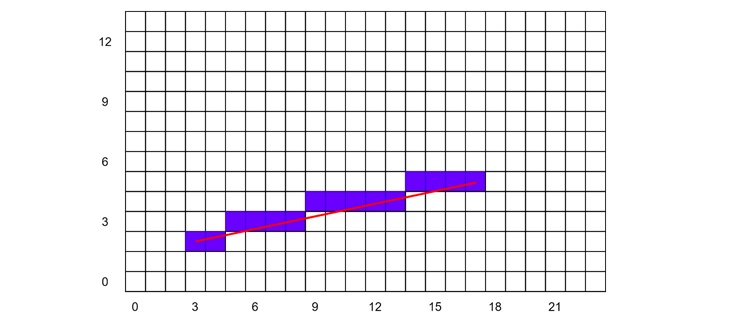

# DirectDraw - Rasterisation and 2D Transformations

This article outlines the topics of rasterisation and 2D transformations:

+ Drawing and clipping lines
+ Drawing wireframe polygons
+ 2D transformations
  - Translations
  - Rotations
  - Scaling
+ Transformations with matrices
  - Translations
  - Scaling
  - Rotations
+ Solid filled polygons
+ Triangulating quadrilaterals
+ Polygon collision detection
+ Timing and synchronisation
+ Scrolling and panning

## Drawing lines

_Rasterisation_ in this context is the process of taking a vector based description of a geometric entity and filling (plotting) pixels from one point to another that most closely fit to the real line. This definition is also extended to other primitives, including triangles (or polygons in general).

Drawing lines on a grid will almost always involve approximations. A line will almost certainly not cross pixels exactly, it may cross two or more, and then comes the questions how or which pixels should be part of the rasterised line.



Taking the equation to a straight line _y = mx + c_ (where _x_ and _y_ are integers), one can draw a line by

1. determining the gradient _m = (y<sub>f</sub> - y<sub>0</sub>)/(<sub>f</sub> - x<sub>0</sub>) 
2. plot the initial point at (x<sub>0</sub>, y<sub>0</sub>)x
3. determine the next value of (x, y) from the gradient _m = (y - y<sub>0</sub>)/(x - x<sub>0</sub>)_
4. repeat until all values of (x, y) until done at (x<sub>f</sub>, y<sub>f</sub>)

The problem with this approach is that the rasterised line will likely contain gaps, particularly if the line is steep. To get around this, one could simply calculate values of y for smaller changes to x. This however still won't work for very steep gradients.

The gradient of the line will ultimately determine the approach taken. If the gradient is greater than one then evidently all rows (y) must have one pixel drawn; similarly, if the gradient is less than one then all columns (x) must be assigned a pixel. 

The process of pixel selection can be handled by _Bresenham's algorithm_. This attempts to select a point (on the rasterised line) that lies closest to the true line. All rasterised points discussed here will be integer based.

A _decision term_ `decX` (and `decY`) is applied and constantly updated based on the previously plotted point.

```cpp
// two endpoints at (x0, y0) and (x2, y1)
int drawLine8bit(
  int x0, int y0, int x1, int y1, UCHAR colour, UCHAR *videoBuffer, int lpitch) {

  int dx,         // difference in x's
      dy,         // difference in y's
      dx2,        // equals (dx*2), used to calc. decX
      dy2,        // equals (dy*2), used to calc. decY
      xInc,       // no. of pixels to move along x-axis
      yInc,       // no. of pixels to move along y-axis
      decX,       // the decision variable in x
      decY;       // the decision variable in y

  // pre-compute first pixel address in video buffer
  videoBuffer = videoBuffer + x0 + y0*lpitch;

  dx = x1 - x0;
  dy = y1 - y0;

  // test which direction the line is going in 
  // and then expect x to change by one unit
  if (dx >= 0){
    xInc = 1;
  } else {
    xInc = -1;

    dx = -dx;  // need |dx|
  } else {
    xInc = 0;
  }

  // test which direction the line is going in 
  // and then expect y to change by one scan line (pitch)
  if (dy >= 0){
    yInc = lpitch;
  } else {
    yInc = -lpitch;

    dy = -dy;  // need |dy|
  } else {
    yInc = 0;
  }

  // constants required for the decision terms
  dx2 = dx << 1;
  dy2 = dy << 1;

  // now draw the line based on the gradient
  if (dx > dy){
    // |m| < 1, eventually we will 
    // move one unit along the x-axis

    // initialise, then update decision in y
    for (decY = dy2 - dx; /**/; x += incX, decY += dy2){
      // plot pixel
      *videoBuffer = colour;

      if (x == x1){
        // at an endpoint, leave
        break;
      }

      if (decY >= 0){
        decY -= dx2;

        // move pointer to next row
        videoBuffer += yInc;
      }
    }

  } else {
    // |m| >= 1, eventually we will 
    // move one unit along the y-axis

    // initialise, then update decision in x
    for (decX = dx2 - dy; /**/; y += incY, decX += dx2){
      // plot pixel
      *videoBuffer = colour;

      if (y == y1){
        // at an endpoint, leave
        break;
      }

      if (decX >= 0){
        decX -= dy2;

        // move pointer to next column
        videoBuffer += xInc;
      }
    }
  } 

  return(1);
}
```
