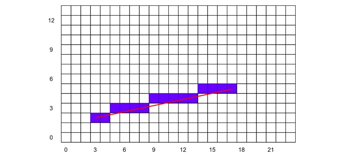
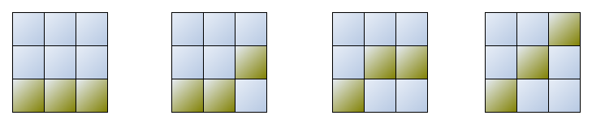
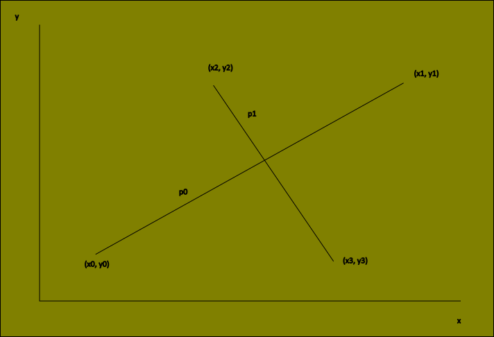
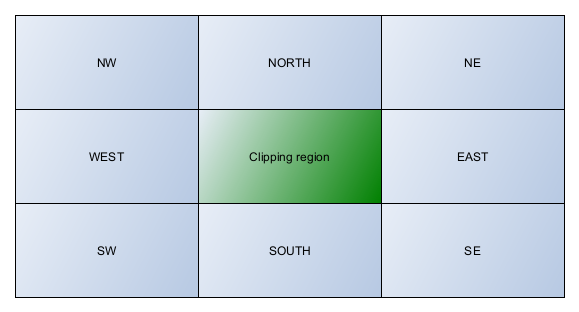
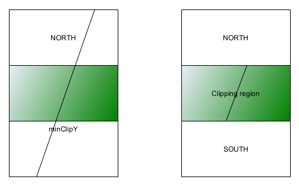
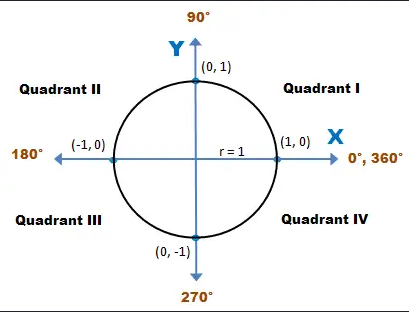
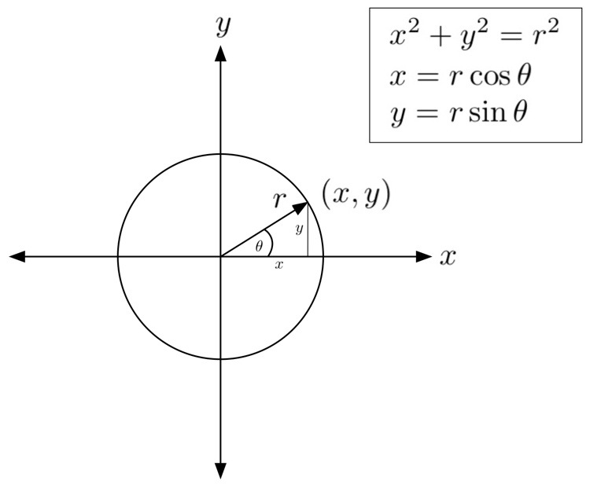

# DirectDraw - Rasterisation and 2D Transformations

This article outlines the topics of rasterisation and 2D transformations:

+ Drawing and clipping lines
+ Drawing wireframe polygons
+ 2D transformations
  - Translations
  - Rotations
  - Scaling
+ Transformations with matrices
  - Translations
  - Scaling
  - Rotations
+ Solid filled polygons
+ Triangulating quadrilaterals
+ Polygon collision detection
+ Timing and synchronisation
+ Scrolling and panning

## Drawing lines with Bresenham's Algorithm

_Rasterisation_ in this context is the process of taking a vector based description of a geometric entity and filling (plotting) pixels from one point to another that most closely fit to the real line. This definition is also extended to other primitives, including triangles (or polygons in general).

Drawing lines on a grid will almost always involve approximations. A line will almost certainly not cross pixels exactly, it may cross two or more, and then comes the questions how or which pixels should be part of the rasterised line.



Taking the equation to a straight line $$y = mx + c$$ (where _x_ and _y_ are integers), one can draw a line by

1. determining the gradient $$m = \frac{y_{f} - y_{0}}{x_{f} - x_{0}}$$
2. plot the initial point at $$(x_{0}, y_{0})$$
3. determine the next value of (x, y) from the gradient $$m = \frac{y - y_{0}}{x - x_{0}}$$
4. repeat until all values of (x, y) until done at $$(x_{f}, y_{f})$$

The problem with this approach is that the rasterised line will likely contain gaps, particularly if the line is steep. To get around this, one could simply calculate values of y for smaller changes to x. This however still won't work for very steep gradients.

The gradient of the line will ultimately determine the approach taken. If the gradient is greater than one then evidently all rows (y) must have one pixel drawn; similarly, if the gradient is less than one then all columns (x) must be assigned a pixel. 

The process of pixel selection can be handled by _Bresenham's algorithm_. This attempts to select a point (on the rasterised line) that lies closest to the true line. All rasterised points discussed here will be integer based.

A _decision term_ `decision` is applied and constantly updated based on the previously plotted point.

```cpp
/*
*Draws a line between two endpoints at (x0, y0) and (x1, y1), 8-bit mode only
*/
int drawLine8bit(int x0, int y0, int x1, int y1, 
				 UCHAR colour, UCHAR *videoBuffer, int lpitch){

	int dx,   // difference in x's
		dy,   // difference in y's
		dx2,  // equals (dx*2), used to calc. error
		dy2,  // equals (dy*2), used to calc. error
		xInc, // no. of pixels to move along x-axis
	    yInc, // no. of pixels to move along y-axis
		decision, // decision variable
		index; // used for looping

	// pre-compute first pixel address in video buffer
	videoBuffer = videoBuffer + x0 + y0*lpitch;

	// compute horizontal and vertical deltas
	dx = x1 - x0;
	dy = y1 - y0;

	// test which direction the line is going in 
	// and then expect x to change by one unit
	if (dx >= 0){
		xInc = 1;
	} else if (dx < 0) {
		xInc = -1;
		dx = -dx; // need absolute value
	} else {
		dx = 0;
	}

	// test which direction the line is going in 
	// and then expect y to change by one scan line (pitch)
	if (dy >= 0){
		yInc = lpitch;
	} else if (dy < 0) {
		yInc = -lpitch;
		dy = -dy;  // need absolute value
	} else {
		dy = 0;
	}

	// prep
	dx2 = dx << 1;
	dy2 = dy << 1;


	if (dx > dy){
		// |m| < 1, eventually we will 
		// move one unit along the x-axis;
		// ignore the else block, this will never run
		// in this case

		// initialise, then update decision in y
		decision = dy2 - dx;
		
		// draw the line
		for (index = 0; index <= dx; index++){
			// plot pixel
			*videoBuffer = colour;
			
			if (decision >= 0){
				// ready to move pointer to next row (y);
				// bring back decision and test again later
				decision -= dx2;
				videoBuffer += yInc;
			}
			
			decision += dy2;
			
			// move to the next column (x)
			videoBuffer += xInc;
		}
	} else {
		// |m| >= 1, eventually we will 
		// move one unit along the y-axis;
		// ignore the if block, that will never run
		// in this case
		decision = dx2 - dy;
		
		// draw the line
		for (index = 0; index <= dy; index++){
			// set the pixel
			*videoBuffer = colour;
			
			// test if error overflowed
			if (decision >= 0){
				// ready to move pointer to next column (x);
				// bring back decision and test again later
				decision -= dy2;
				videoBuffer += xInc;
			}
			
			decision += dx2;
			
			// move to the next row (y)
			videoBuffer += yInc;
		}
	}

	// return success
	return(1);
}
```

It's possible to optimise the above algorithm in a number of ways:

+ ignore functions of lines e.g. `y = x`, `y = constant` or `x = constant`, these do not require Bresenham's algorithm
+ for straight line functions, rasterise up to the midpoint and then copy the line after the midpoint
+ if possible, identify a set of points (parts of the rasterised line) that resemble a constant function (as a _run_) that could be handled without Bresenham's algorithm (this optimisation yields the _Run-Slicing_ algorithm)
+ consider applying the _Symmetric Double-Step_ algorithm: this recognises that for every two points, a line segment can only be composed of one of four 3x3 patterns (below), or a 90 degree rotated version of the pattern. The algorithm looks at the decision (or error) term to decide which pattern to render before continuing along the line and is generally much quicker than Bresenham's algorithm.



## Clipping in 2D

Clipping bitmaps is achieved by overlapping the bitmap's bounding rectangle with the viewport's rectangle. The intersection of both rectangles would be the area to blit.

Clipping lines is (computationally) relatively more difficult to do. Given a clipping rectangle and a line, one will need a clipping filter to identify where the line(s) intersect with the clipping rectangle boundaries.

Overall, the clipping process checks:

a. if a line segment (i.e. both endpoints) lies completely within the clipping rectangle
b. if a line segment lies completely outside the clipping rectangle
c. otherwise perform intersection calculations with one or more clipping boundaries

Before outlining line clipping, we review a few basic mathematical prerequisites.

### Finding the intersection of two lines using point-slope form



Using the point-slope form of the equation to a line:

$$
y - y_{0} = m(x - x_{0})
$$

We have the point of intersection (x, y) for lines that have segments `p0` and `p1` with gradients `m0` and `mq` respectively:

$$
y_{1} - y_{0} = m0(x_{1} - x_{0}) \\
y_{3} - y_{2} = m1(x_{3} - x_{2})
$$

Or for any point along each line with, for example:

$$
y - y_{0} = m_{0}(x - x_{0}) \\
y - y_{2} = m_{1}(x - x_{2})
$$

Solving for a point of intesection at (x, y):

$$
x = \frac{-m_{0}x_{2}}{m_{1} - m_{0}} + m_{0}(y_{2} - y_{0}) + x_{0}
$$

$$
y = \frac{m_{0}y_{0} - m_{1}y_{2} + x_{2} - x_{0}}{m_{0} - m_{1}}
$$

Note from above that if both lines are parallel, then `|m1| = |m0|` and they cannot intersect. The above
equations would yield zero as denominators.

#### Finding the intercept of a line using the general form

Using the general form of the equation to a line:

$$
ax + by = c
$$

Or for some other value of `c` as:

$$
ax + by + c = 0
$$

Taking the above point-slope form and equating coefficients `a`, `b` and `c` in terms of the gradients `m`, and an intercept at `x = 0`, we
have:

$$
y - y_{0} = m(x - x_{0}) \\
y - y_{0} = mx - mx_{0}
$$

Then we have the general form for the line:

$$
-mx + y = y_{0} - mx_{0} \\
$$

Then as:

$$
mx - y = mx_{0} - y_{0}
$$

The intercept is $mx_{0} - y_{0}$.

#### Finding the intersection of two lines in Matrix form

Two lines in general form can be expressed as a matrix.

$$
a_{1}x + b_{1}y = c_{1} \\
a_{2}x + b_{2}y = c_{2}
$$

The matrix is given by: __Ax__ = __Y__, with __A__:

__A__ = 
$$
\begin{bmatrix}
a1 & b1 \\
a2 & b2
\end{bmatrix}
$$

and __x__ = 

$$
\begin{bmatrix}
x \\
y
\end{bmatrix}
$$

and finally __Y__ =

$$
\begin{bmatrix}
c1 \\
c2
\end{bmatrix}
$$

To solve for the intersection at (x, y) one can use determinants:

$$
x = \frac{det(A1)}{det(A)}
$$

$$
y = \frac{det(A2)}{det(A)}
$$

The matrices A1 (in y) and A2 (in x) are defined here as:

__A1__ =
$$
\begin{vmatrix}
c1 & b1 \\
c2 & b2
\end{vmatrix}
$$

__A2__ = 
$$
\begin{vmatrix}
a1 & c1 \\
a2 & c2
\end{vmatrix}
$$

The determinant (a scalar) for a 2x2 matrix for e.g. A1 and A2 are

$$
det(A1) = c_{1}b_{2} - b_{1}c_{2} \\
det(A2) = a_{1}c_{2} - c_{1}a_{2}
$$

Then knowing 

$$
det(A) = a_{1}b_{2} - b_{1}a_{2}
$$

Then the solutions are

$$
x = \frac{c_{1}b_{2} - b_{1}c_{2}}{a_{1}b_{2} - b_{1}a_{2}} 
$$

$$
y = \frac{a_{1}c_{2} - c_{1}c_{2}}{a_{1}b_{2} - b_{1}a_{2}} 
$$

### Clipping lines with the Cohen-Sutherland Algorithm

To reiterate, an clipping algorithm needs to determine:

a. if a line segment (i.e. both endpoints) lies completely within the clipping rectangle
b. if a line segment lies completely outside the clipping rectangle
c. otherwise perform intersection calculations with one or more clipping boundaries

To reduce unnecessary calculations, the _Cohen-Sutherland Algorithm_ breaks up the task by defining sectors external to the clipping region. Any line segments or parts of line segments located in these sectors are omitted from the viewport.



Each distinct sector is typically given a clip code so as to determine quickly what clipping is required.

The complete function `clipLine()` is given below. Taking a couple of examples, for the endpoint (x1, y1) found to reside in Clip code NORTH and SOUTH:




```cpp
case CLIP_CODE_N:
  {
    // deduced: y1 > maxClipY

    // make sure y1 does not exceed upper limit
    y1Clipped = maxClipY;

    // offset x accordingly
    x1Clipped = x1 + 0.5 + (maxClipY-y1)*(x2-x1)/(y2-y1);
  } break;
```

The complete function:

```cpp
/*
* Clips a line by updating the endpoints (x1, y1) and (x2, y2)
*/
int clipLine(int &x1, int &y1, int &x2, int &y2){

	// internal clipping codes
	#define CLIP_CODE_C  0x0000 // completely in clipping region
	#define CLIP_CODE_N  0x0008 // crosses top edge (bits 1000)
	#define CLIP_CODE_S  0x0004 // crosses bottom edge (bits 0100)
	#define CLIP_CODE_E  0x0002 // crosses right edge (bits 0010)
	#define CLIP_CODE_W  0x0001 // crosses left edge (bits 0001)

	#define CLIP_CODE_NE 0x000a // bits 1010
	#define CLIP_CODE_SE 0x0006 // bits 0110
	#define CLIP_CODE_NW 0x0009 // bits 1001
	#define CLIP_CODE_SW 0x0005 // bits 0101

	// this function updates the passed coords;
	// store them here temporarily and update
	// at the end if all OK
	int x1Clipped = x1, 
		y1Clipped = y1, 
		x2Clipped = x2, 
		y2Clipped = y2;

	// points 1 and 2 clip codes
	int p1_code = 0, 
		p2_code = 0;

	// determine codes for p1 and p2
	if (y1 < minClipY)
		p1_code |= CLIP_CODE_S;
	else
	if (y1 > maxClipY)
		p1_code |= CLIP_CODE_N;

	if (x1 < minClipX)
		p1_code |= CLIP_CODE_W;
	else
	if (x1 > maxClipX)
		p1_code |= CLIP_CODE_E;

	if (y2 < minClipY)
		p2_code |= CLIP_CODE_S;
	else
	if (y2 > maxClipY)
		p2_code |= CLIP_CODE_N;

	if (x2 < minClipX)
		p2_code |= CLIP_CODE_W;
	else
	if (x2 > maxClipX)
		p2_code |= CLIP_CODE_E;

	// try and trivially reject
	if ((p1_code & p2_code)) 
		return(0);

	// test for totally visible, if so leave points untouched
	if (p1_code == 0 && p2_code == 0)
		return(1);

	// determine end clip point for p1
	switch(p1_code){
		case CLIP_CODE_C: 
			break;

		case CLIP_CODE_N:
			{
				y1Clipped = maxClipY;
				x1Clipped = x1 + 0.5 + 
				  (maxClipY-y1)*(x2-x1)/(y2-y1);
			} break;

		case CLIP_CODE_S:
			{
				y1Clipped = minClipY;
				x1Clipped = x1 + 0.5 + 
				  (minClipY-y1)*(x2-x1)/(y2-y1);
			} break;

		case CLIP_CODE_W:
			{
				x1Clipped = minClipX;
				y1Clipped = y1 + 0.5 + 
				  (minClipX-x1)*(y2-y1)/(x2-x1);
			} break;

		case CLIP_CODE_E:
			{
				x1Clipped = maxClipX;
				y1Clipped = y1 + 0.5 + 
				  (maxClipX-x1)*(y2-y1)/(x2-x1);
			} break;

		// these cases are more complex, must compute 2 intersections
		case CLIP_CODE_NE:
			{
				// north hline intersection
				y1Clipped = maxClipY;
				x1Clipped = x1 + 0.5 + 
				  (maxClipY-y1)*(x2-x1)/(y2-y1);

				// test if intersection is valid
				if (x1Clipped < minClipX || x1Clipped > maxClipX){
					// east vline intersection
					x1Clipped = maxClipX;
					y1Clipped = y1 + 0.5 + 
					  (maxClipX-x1)*(y2-y1)/(x2-x1);
				}
			} break;

		case CLIP_CODE_SE:
			{
				// south hline intersection
				y1Clipped = minClipY;
				x1Clipped = x1 + 0.5 + 
				  (minClipY-y1)*(x2-x1)/(y2-y1);
				
				// test if intersection is valid
				if (x1Clipped < minClipX || x1Clipped > maxClipX){
					// east vline intersection
					x1Clipped = maxClipX;
					y1Clipped = y1 + 0.5 + 
					  (maxClipX-x1)*(y2-y1)/(x2-x1);
				}
			} break;
		 
		case CLIP_CODE_NW:
			{
				// north hline intersection
				y1Clipped = maxClipY;
				x1Clipped = x1 + 0.5 + 
				  (maxClipY-y1)*(x2-x1)/(y2-y1);
				
				// test if intersection is valid
				if (x1Clipped < minClipX || x1Clipped > maxClipX){
					x1Clipped = minClipX;
					y1Clipped = y1 + 0.5 + 
					  (minClipX-x1)*(y2-y1)/(x2-x1);	
				}
			} break;
		
		case CLIP_CODE_SW:
			{
				// south hline intersection
				y1Clipped = minClipY;
				x1Clipped = x1 + 0.5 + 
				  (minClipY-y1)*(x2-x1)/(y2-y1);
				
				// test if intersection is valid
				if (x1Clipped < minClipX || x1Clipped > maxClipX){
					x1Clipped = minClipX;
					y1Clipped = y1 + 0.5 + 
					  (minClipX-x1)*(y2-y1)/(x2-x1);
				}
			} break;
		
		default:break;
	}

	// determine clip point for p2
	switch(p2_code){
		case CLIP_CODE_C: break;

		case CLIP_CODE_N:
			{
				y2Clipped = maxClipY;
				x2Clipped = x2 + (maxClipY-y2)*(x1-x2)/(y1-y2);
			} break;
		
		case CLIP_CODE_S:
			{
				y2Clipped = minClipY;
				x2Clipped = x2 + (minClipY-y2)*(x1-x2)/(y1-y2);
			} break;
		
		case CLIP_CODE_W:
			{
				x2Clipped = minClipX;
				y2Clipped = y2 + (minClipX-x2)*(y1-y2)/(x1-x2);
			} break;
		
		case CLIP_CODE_E:
			{
				x2Clipped = maxClipX;
				y2Clipped = y2 + (maxClipX-x2)*(y1-y2)/(x1-x2);
			} break;
			
		// these cases are more complex, must compute 2 intersections
		case CLIP_CODE_NE:
			{
				// north hline intersection
				y2Clipped = maxClipY;
				x2Clipped = x2 + 0.5 + 
				  (maxClipY-y2)*(x1-x2)/(y1-y2);
				
				// test if intersection is valid
				if (x2Clipped < minClipX || x2Clipped > maxClipX){
					// east vline intersection
					x2Clipped = maxClipX;
					y2Clipped = y2 + 0.5 + 
					  (maxClipX-x2)*(y1-y2)/(x1-x2);
				}
			} break;
		
		case CLIP_CODE_SE:
			{
				// south hline intersection
				y2Clipped = minClipY;
				x2Clipped = x2 + 0.5 + 
				  (minClipY-y2)*(x1-x2)/(y1-y2);
				
				// test if intersection is valid
				if (x2Clipped < minClipX || x2Clipped > maxClipX){
					// east vline intersection
					x2Clipped = maxClipX;
					y2Clipped = y2 + 0.5 + 
					  (maxClipX-x2)*(y1-y2)/(x1-x2);
				}
			} break;
		
		case CLIP_CODE_NW:
			{
				// north hline intersection
				y2Clipped = maxClipY;
				x2Clipped = x2 + 0.5 + 
				  (maxClipY-y2)*(x1-x2)/(y1-y2);
				
				// test if intersection is valid
				if (x2Clipped < minClipX || x2Clipped > maxClipX){
					x2Clipped = minClipX;
					y2Clipped = y2 + 0.5 + 
					  (minClipX-x2)*(y1-y2)/(x1-x2);
				}
			} break;
		
		case CLIP_CODE_SW:
			{
				// south hline intersection
				y2Clipped = minClipY;
				x2Clipped = x2 + 0.5 + 
				  (minClipY-y2)*(x1-x2)/(y1-y2);
				
				// test if intersection is valid
				if (x2Clipped < minClipX || x2Clipped > maxClipX)
				{
					x2Clipped = minClipX;
					y2Clipped = y2 + 0.5 + 
					  (minClipX-x2)*(y1-y2)/(x1-x2);
				}
			} break;
		
		default:break;
	}

	// do bounds check
	if ((x1Clipped < minClipX) || (x1Clipped > maxClipX) ||
		(y1Clipped < minClipY) || (y1Clipped > maxClipY) ||
		(x2Clipped < minClipX) || (x2Clipped > maxClipX) ||
		(y2Clipped < minClipY) || (y2Clipped > maxClipY) ){
			return(0);
	} 

	// update coords
	x1 = x1Clipped;
	y1 = y1Clipped;
	x2 = x2Clipped;
	y2 = y2Clipped;

	return(1);
}
```

## Wireframe polygons

Wireframe polygons are polygons that are not filled, or are hollowed. Polygons consist of three or more points (vertices) each joined by an edge, and are always closed. Polygons can be _concave_ (there exists a connecting line between two edges where the line falls outside the polygon) and _convex_ (in short, are not concave).

Polygons will not always have a fixed point count, so the data structure that stores polygons will utilise the heap to a degree. Each vertex can be represented by a structure:

```cpp
typedef struct VERTEX2DI_TYP {
	int x, y;
} VERTEX2DI, *VERTEX2DI_PTR;
```

Each vertex is stored in a array of type `VERTEX2DI_TYP`, in another structure:

```cpp
typedef struct POLYGON2DI_TYP {
	int state;
	int numVerts;
	int x0, y0;
	int xv, yv;
	DWORD colour;
	VERTEX2DI *vList;
} POLYGON2DI, *POLYGON2DI_PTR;
```

The naming convention `2DI` emphasises `int` (x, y). This is fine for now but will be updated to support `float` (x, y) as `2DF`, to maintain some level of accuracy during transformations (demonstrated later).

To initialise e.g. a triangle:

```cpp
POLYGON2DI triangle;

triangle.state = 1; // e.g. enabled/viewable
triangle.numVerts = 3;
triangle.x0 = 100;
triangle.y0 = 100;
triangle.xv = 0; // initial velocity
triangle.yv = 0;
triangle.colour = 50; // assuming 8-bit, colour index 50
triangle.vList = new VERTEX2DI[triangle.numVerts];
```

The central point (x0, y0) tends to be used to translate the polygon _en masse_, preserving the
relative position of the vertices. The _local coordinates_ are coordinates relative to the central point 
and each vertex is normally described as local coordinates. A polygon is transformed via _global coordinates_ (discussed later).

Drawing a polygon is an extension of drawing lines and is given below:

```cpp
int draw2DIPolygon8Bit(POLYGON2DI_PTR polygon, UCHAR *videoBuffer, int lPitch){
	if (polygon->state){
		int index;
		for (index = 0; index < polygon->numVerts - 1; index++){
			drawClipLine8bit(
				// first endpoint
				polygon->vList[index].x + polygon->x0,
				polygon->vList[index].y + polygon->y0,
				// next endpoint
				polygon->vList[index + 1].x + polygon->x0,
				polygon->vList[index + 1].y + polygon->y0,
				polygon->colour,
				videoBuffer,
				lPitch);
		}

		// close the polygon
		drawClipLine8bit(
				// first endpoint
				polygon->vList[0].x + polygon->x0,
				polygon->vList[0].y + polygon->y0,
				// next endpoint
				polygon->vList[index].x + polygon->x0,
				polygon->vList[index].y + polygon->y0,
				polygon->colour,
				videoBuffer,
				lPitch);

		return(1);
	}

	return(0);
}
```

## Transformations

### Translation

A _translation_ is a bout moving an object from one point to another. The global coordinates assume the origin is at the top-left corner of the viewport. It then follows that the translation by `(dx, dy)` to give the new global coordinates `(xt, yt)` is:

$$
xt = x + dx; \\
yt = y + dy;
$$

A translation to a position to the lower-right would require `dx > 0` and `dy > 0`. Similarly, a translation to the lower-left position would require `dx < 0` and `dy > 0`.

```cpp
int translatePolygon2D(POLYGON2D_PTR polygon, int dx, int dy){
	if (!polygon){
		return (0);
	}

	polygon->x0 += dx;
	polygon->y0 += dy;

	return(1);
}
```

### Rotation

Rotation is a more involved operation. Taking a standard cartesian coordinate system:



+ Quadrant I - sine(x), cosine(x) and tangent(x) are all positive
+ Quadrant II - sine(x) > 0
+ Quadrant I - tangent(x) > 0
+ Quadrant I - cosine(x) > 0

Some conventions in 2D:

+ rotation occurs about an axis perpendicular to the 2D plane in a anticlockwise motion
+ C and C++ sine and cosine functions work with radians only

Later, we will outline how to map (transform) the standard viewport (with the origin at the top-left) with the four quadrants shown above.

It is also worth noting the following trigonometric identities with C and C++:

+ `csc(theta) = 1/sin(theta)`
+ `sec(theta) = 1/cos(theta)`
+ `cot(theta) = 1/tan(theta)`

Other useful identities include:

$$
sin^{2}{\theta} + cos^{2}{\theta} = 1
$$

For conversion: 

$$
sin{\theta} = cos{(\theta - \frac{\pi}{2})}
$$

For reflection:

$$
sin{\theta} = -sin{\theta}
$$

$$
cos{(-\theta)} = cos{\theta}
$$

For addition:

$$
sin{(\theta_{1} + \theta_{2})} = sin{\theta_{1}}cos{\theta_{2}} + cos{\theta_{1}}sin{\theta_{2}}
$$

$$
cos{(\theta_{1} + \theta_{2})} = cos{\theta_{1}}cos{\theta_{2}} - sin{\theta_{1}}sin{\theta_{2}}
$$

$$
sin{(\theta_{1} - \theta_{2})} = sin{\theta_{1}}cos{\theta_{2}} - cos{\theta_{1}}sin{\theta_{2}}
$$

$$
cos{(\theta_{1} - \theta_{2})} = cos{\theta_{1}}cos{\theta_{2}} + sin{\theta_{1}}sin{\theta_{2}}
$$

Referring to quadrant 1 for the moment, for a circle of radius `r`, one can characterise the polar coordinates of a point (or vertex) as:

$$
x = r cos{\theta} \\
y = r sin{\theta}
$$

Pictorially:



If one were to rotate an additional $$\alpha$$ radians, then the resultant polar coordinates on the same axes would be:

$$
x_{rot} = r cos{(\theta + \alpha)} \\
y_{rot} = r sin{(\theta + \alpha)}
$$

It would be reasonable to see that on rotating anticlockwise, one can state $$x_{rot} < x$$ and $$y_{rot} > y$$. Taking the addition identity, rotating (x, y) by some angle $$\alpha$$, then along the abscissa:

$$
x_{rot} = r cos{(\theta + \alpha)} \\
x_{rot} = r (cos{\theta}cos{\alpha} - sin{\theta}sin{\alpha}) \\
x_{rot} = xcos{\alpha} - ysin{\alpha}
$$

Along the ordinate:

$$
y_{rot} = r sin{(\theta + \alpha)} \\
y_{rot} = r (sin{\theta}cos{\alpha} + cos{\theta}sin{\alpha}) \\
y_{rot} = ycos{\alpha} + xsin{\alpha}
$$

To conclude:

$$
x_{rot} = xcos{\alpha} - ysin{\alpha} \\ 
y_{rot} = xsin{\alpha} + ycos{\alpha}
$$

To reduce demand on the application, one should devise a lookup table to convert between degrees and radians during initialisation:

```cpp
const double PI = 3.1415926535;

float cosLookup[360];
float sinLookup[360];

for (int ang = 0; ang < 360; ang++){
    // convert ang to radians
    float thetaRad = (float)ang*PI/(float)180;

    // insert next entry into table
    cosLookup[ang] = cos(thetaRad);
    sinLookup[ang] = sin(thetaRad);
}
```

Thus, looking up e.g. `cosLookup[5]` is equivalent to finding the $$cos{(5)}$$, for some angle 5 degrees.

Given that there would be a loss of accuracy when determining new coordinates (x, y) for small rotations, the above vertex list should be defined as a `float` (x, y) version, as:

```cpp
typedef struct VERTEX2DF_TYP {
	int x, y;
} VERTEX2DF, *VERTEX2DF_PTR;
```

Each vertex is stored in a array of type `VERTEX2DF_TYP` (F for `float`), in another structure:

```cpp
typedef struct POLYGON2DF_TYP {
	int state;
	int numVerts;
	int x0, y0;
	int xv, yv;
	DWORD colour;
	VERTEX2DF *vList;
} POLYGON2DF, *POLYGON2DF_PTR;
```

The draw and rotation functions would take the form:

```cpp
int draw2DFPolygon8Bit(POLYGON2DF_PTR polygon, UCHAR *videoBuffer, int lPitch){
	if (polygon->state){
		int index;
		for (index = 0; index < polygon->numVerts - 1; index++){
			drawClipLine8bit(
				// first endpoint
				polygon->vList[index].x + polygon->x0,
				polygon->vList[index].y + polygon->y0,
				// next endpoint
				polygon->vList[index + 1].x + polygon->x0,
				polygon->vList[index + 1].y + polygon->y0,
				polygon->colour,
				videoBuffer,
				lPitch);
		}

		// close the polygon
		drawClipLine8bit(
				// first endpoint
				polygon->vList[0].x + polygon->x0,
				polygon->vList[0].y + polygon->y0,
				// next endpoint
				polygon->vList[index].x + polygon->x0,
				polygon->vList[index].y + polygon->y0,
				polygon->colour,
				videoBuffer,
				lPitch);

		return(1);
	}

	return(0);
}

int rotatePolygon2D(POLYGON2DF_PTR poly, int thetaDeg){
	if (!poly)
		return(0);

	for (int currVert = 0; currVert < poly->numVerts; currVert++){
		
		float xr = 
			(float) poly->vList[currVert].x * cosLookup[thetaDeg] - 
				(float) poly->vList[currVert].y * sinLookup[thetaDeg];

		float yr = 
			(float)poly->vList[currVert].x * sinLookup[thetaDeg] + 
				(float)poly->vList[currVert].y * cosLookup[thetaDeg];

		poly->vList[currVert].x = xr;
		poly->vList[currVert].y = yr;
	}

	// return success
	return(1);
}
```

Generally, one should rotate the central point (about an axis) of a polygon and then refer to the local coordinates when rendering the new position of the polygon. Otherwise, with multiple rotations and loss of accuracy, it's possible to distort the original shape of the polygon.
